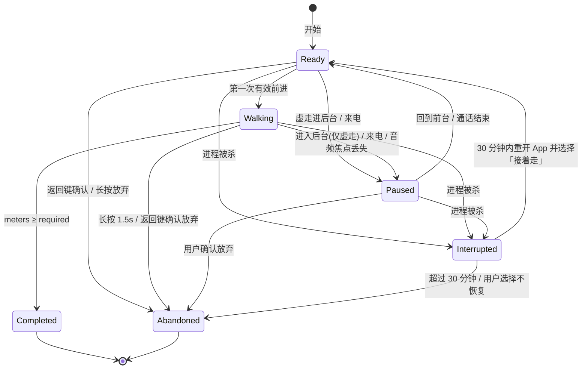

# 慢行 · SenseWalk

> 一款帮助人**培养耐心、缓解压力**的 Android 应用。  
> **先选场景，再选怎么走**——雨林 / 森林 / 沙漠 / 城市（及可选夜径）各有声音与景色身份。  
> **用双脚走完距离才能通关**；感官层与景色层随路程渐渐解锁。  
> 虚走摇杆教你找**舒适节奏**（拉满≠最快）；路径有起伏，角色随地形爬坡、跳跃。  
> 不可跳过、不可加速、不可提前通关。

**文档版本**：v0.8 · 2026-10-12 仓库现状评审与可执行开发计划；保留 v0.7 的产品机制  
**本轮更新**：先看 [§0 当前进度](#0-当前进度仓库核查2026-10-12)、[§13 分阶段交付](#13-里程碑)、[§20 完善与改进](#20-完善与改进v08)。v0.7 的历史修正保留在 [§19 评审记录](#19-v07-评审记录合理性检查)。  
**仓库**：[github.com/skydream9527-ctrl/sense-walk](https://github.com/skydream9527-ctrl/sense-walk)  
**可视化方案页**：[docs/plan.html](./docs/plan.html)（可双击打开；v0.8 摘要）。规则与交付状态以本文件为准；HTML demo 是交互原型，不能代替 Android 实现验收。

---

## 0. 当前进度（仓库核查，2026-10-13 · T06 后）

**2026-10-14追加核查**：main为da9bd24。SW-002候选已获独立approved，实际生产光效仍程序降级，SW-010待正式接线；ZCode PR #1的21份云端JUnit XML实际统计238项全通过，但未合入，detector注册失败cue回退与低步数同刻合并需R2复验。Trae本机43文件设计草稿未共享提交，不能标设计approved。下一交付物先收口这些任务，之后再做T07。当前分工、原始新证据与完整提示词见 [最新核查](./docs/collaboration/evidence/P-20261014-01/README.md)、[协作入口](./docs/collaboration/README.md)；以下保留13日实现快照。

**结论：T01–T06 已合入 main（T05 记录见 §20.8–§20.9，定点修复见 §20.10，T06 实走记录见 §20.11，Actions 全绿）。** 森林 800 m 虚走可通关/放弃且感官层为真实引擎 + 真实素材；**森林实走（counter 计步 + health 前台服务）已实现并经模拟器链路验证**；其他场景诚实标「暂未开放」。标准 800 m 真人手动验收、真机耳机/来电/实走计步/锁屏 15 分钟与问题视觉层重制未完成前，**M1 不宣布完成**。以下依据源码与 CI，不把 HTML demo 当 Android 完成证据。

| 模块 | 已有内容 / 源码证据 | 与目标的差距 |
| --- | --- | --- |
| 工程与导航 | Home → 模式选择 → 会话（虚走/实走） → 结果；Navigation / DataStore | 雨林/城市未进主流程 |
| 场景 | schema v2 JSON（森林/沙漠/夜径）；SceneValidator；Loading/Ready/Error | 雨林/城市配置与入口未齐；森林素材已真实化，沙漠/夜径仍显式占位 |
| 会话 | 虚走：`VirtualWalkController` + comfort_v1 摇杆、门禁、相位、ForestShell 黑幕起笔，后台暂停不偷跑；实走：`RealWalkController`/`RealWalkEngine`（counter 唯一计距）+ `WalkForegroundService`（health 前台、单一会话源） | 地形越坎属 T07 |
| 结果页 | Completed / Abandoned，展示实际米数 | 用时折叠等打磨可继续 |
| 感官 | `SensoryCoordinator` + `AndroidSensoryBackend`（SoundPool 脚步/MediaPlayer 循环/Vibrator）；森林真实素材入库（`REQUIRE_REAL_ASSETS` 放行）；焦点门控全部出声入口（被拒零脚步零 loop，获准不补播不重复建层，调用链测试锁定） | 振动待真机验证（模拟器无 HAL）；light_shows/clearing 程序降级待 MiniMax 重制 |
| 设置 | 振动、节奏提示、减少动效、按住前进、手动暂停等已接入偏好 | 步长/GPS 等属后续 |
| 实走与生命周期 | TYPE_STEP_COUNTER 计距（首事件基线、1.4 m/s 封顶、重复/乱序/下降/暂停不补算）；detector 仅步伐 cue（400ms 节流）；权限/硬件缺失诚实回退虚走；通知返回+停止；终态三清（服务/通知/播放器） | 真实计步、锁屏 15 分钟、权限拒绝流转待真机 |
| 验证 | JVM 单测 217 个覆盖领域、虚走集成、播放边界与 S5/S8；GitHub Actions 打包/lint/test；模拟器验证：虚走 800 m 全程走查 + 实走服务链路（注入冒烟，不冒充真实计步） | 真人标准 800 m 手动验收与真机耳机/来电/实走属「待验证」 |
| 设计包 | `design/` PRD 级设计 + HTML demo | demo 不接 Android 距离引擎；验收以本文件 + design 为准 |

**下一交付物**：T07 快照恢复/地形越坎/雨林。遗留待办：标准 800 m 手动验收、真机耳机/来电/实走计步/锁屏验证、MiniMax 问题层重制（见 ASSETS.md）。

---

## 1. 产品愿景

### 一句话

选一个有声音与景色身份的场景，用虚走或实走把要求距离走完；路上从一片黑幕开始，脚步、环境音、振动与风景一步步随路程长出——**练习耐心与放松**，而不是刷白噪音、冲刺或跳关。

### 核心不变（继承 v0.3–v0.5，不可削弱）

- **进度 = 有效距离**，不是已过时间  
- **双模式**：手机控角色（虚走）/ 户外实走  
- **通关门禁**：未满 `requiredDistanceMeters` 不能通关；长按 = 放弃  
- **不可跳过、不可加速**（含视觉揭示）  
- 感官层与景色层按 **`atMeters`** 淡入；会话从黑幕起笔  
- **先选场景**；各景声音 / 景色身份不同，解锁机制相同  

### v0.6 增量

- **定位强调**：培养耐心、缓解压力——慢感官行走本身就是练习  
- **舒适节奏摇杆**（主要虚走）：摇杆→速度曲线**非单调 / 有甜点区**；中段偏转 ≈ 舒适步行；**拉满不是最快**，急推反而变钝，教用户放松找节奏  
- **地形联动移动**：背景路径非平地；角色随地形爬坡、跳跃等；仅**有效前进**计距；地形鼓励正念慢走，不做高压平台跳跃考验  

### 目标用户 / 非目标 / 原则

同 v0.3：耐心约束、无社交排行、无跳过道具、少即是多、诚实且温柔、无打扰。  
原则补充：

- **场景有辨识度，规则无歧义**——换皮肤不换门禁  
- **耳目同程**——听见与看见按同一路程节奏展开  
- **急无用**——冲摇杆、冲地形只会更累、更慢或无效刷距  
- **减压优先**——地形难度服务于「慢下来」，不诱发挫败焦虑  

---

## 2. 开局流程（Home）

```
进入 App
  → ① 场景选择（大卡片：雨林 / 森林 / 沙漠 / 城市 / …）
  → ② 模式选择（手机控角色 · 虚走  |  户外实走）
  → ③ 点「开始」→ 请求必要权限 → 进入关卡会话
```

- 场景卡片展示：名称、短情绪词、**要求距离**、极弱场景色（**不是**完整风景预览）  
- 模式在选景之后；会话中途不可换场景或模式  
- 冷启动到开步目标 ≤ 4 次有效点击（含选模式）  
- **景色层层展开只发生在会话内**，选景页保持克制、暗色卡片即可  

---

## 3. 双模式行走

### 3.1 虚走（Virtual Walk）

屏幕**虚拟摇杆 / 摇杆**控制角色沿路径前进。

| 规则 | 说明 |
| --- | --- |
| 输入 | 摇杆偏转量 \(d \in [0,1]\)（方向沿路径前进轴；倒退不计有效进度） |
| 速度映射 | **舒适甜点曲线**（见 §4），非「推越满越快」 |
| 硬顶 | 瞬时速度 ≤ **1.4 m/s**（步行感上限，与历史计划一致） |
| 禁止 | 冲刺键、倍速、加速条、作弊快清门禁 |

角色动画随地形切换：平地走、上坡攀、过坎跳等（见 §5）。

### 3.2 实走（Real Walk）

`STEP_COUNTER` / `STEP_DETECTOR` × 步长为主；可选 Fused Location；~~活动识别车载则暂停~~ → v0.7：车载判断改为 GPS 速度 + 步频（§3.2.1）；统一速度帽。

| 与「舒适节奏」的关系 | 说明 |
| --- | --- |
| **无摇杆** | 户外以真实步伐累计距离 |
| 可选平静提示 | 若步频持续过高（如折合 > ~1.4 m/s 或明显高于舒适步频），可极轻 haptic / 文案「放慢一点」——**不惩罚通关资格**，只提醒 |
| 景色 / 门禁 | 与虚走相同：黑幕起笔、按距解锁、满距才通关 |
| 地形表现 | 屏幕可更克制；若展示路径剪影，起伏仅作氛围，**不要求户外做跳跃操作** |

权限：计步（`ACTIVITY_RECOGNITION`）；位置仅在用户开启 GPS 辅助时请求。

#### 3.2.1 计距细节（v0.7）

| 项 | 规则 |
| --- | --- |
| 主数据源 | `TYPE_STEP_COUNTER`（硬件累计，省电、锁屏也在数）；会话开始时记下基线值，之后只看增量 |
| 步事件 | `TYPE_STEP_DETECTOR` 只用来**触发脚步音**（§8.2），不用来计距，避免重复计数 |
| 步长 | 设置里的 `strideMeters`，默认 0.70 m；可以填身高估算（身高 × 0.415） |
| 速度帽 | 每次传感器事件：`Δd = min(Δsteps × stride, 1.4 m/s × Δt)`；Δt 用事件时间戳，兼容批量上报 |
| 跑步 | 步频持续 20 s 超过 140 步/分 → 平静提示「放慢一点」（只提示一次，可关）；距离照样按速度帽算 |
| 车载 / 骑车 | **MVP 不依赖 Google Play 服务的活动识别**（国内很多机器没有）。没开 GPS 时，计步器在车上基本不涨，加上速度帽已经够用；后续开启 GPS 时，GPS 速度 > 3 m/s 且步频 < 60 步/分 持续 10 s → 暂停累计，并提示「好像在车上，先停一下」 |
| 没有计步传感器 | MVP 计距要求 `TYPE_STEP_COUNTER`；缺失则实走入口置灰，提示「这台手机不支持此计步模式，可以试试虚走」。只有 counter、没有 detector 的设备仍可实走，但降级脚步反馈，不把批量步数补播成密集脚步音 |
| GPS 辅助（可选） | 只用来**校准步长**：一局结束时，如果 GPS 距离可信（精度 < 15 m、轨迹 > 200 m），就把 `GPS 距离 / 步数` 作为新步长建议，**需要用户确认**才保存；不直接计入进度 |

#### 3.2.2 锁屏与前台服务（v0.7，解决 R4）

- 实走开始 → 从可见 Activity、权限满足后启动 `WalkForegroundService`；计步使用 `health`，后台音频启用 `mediaPlayback`，若 GPS 也要在锁屏持续运行则启用 `location`。按实际运行能力传入类型并声明对应权限（§12.5），不从后台无条件自启动  
- 常驻通知：「慢行 · 森林 · 正在走」，**不在通知里显示米数**（避免一直盯着数字看）；提供返回会话与停止入口，停止按放弃处理  
- 服务里跑：计步监听、`ProgressAccumulator`、`PhaseScheduler`、音频播放、振动  
- 结束 / 放弃 / 通关 → 立即停止服务  
- 首次实走时提示可以把应用加入电池优化白名单（只提示一次，不强制）

#### 3.2.3 实走的「耳目同程」（v0.7，解决 R5）

实走大多数时间手机在口袋里，**听觉是主线，视觉是「抬眼看到的」**：

- 锁屏时视觉不渲染（省电），但 `PhaseScheduler` 照样按米数推进视觉状态  
- 亮屏回到会话页时，景色从黑幕用 **2–3 s 淡入到当前米数对应的状态**——这是已经走出来的，不算「跳过」  
- 75% / 95% 的视觉相位（§8.1）在实走里额外配一个很轻的提示音，告诉用户「可以拿出来看看」（可关）

---

## 4. 舒适节奏摇杆（v0.6 专章 · 主要虚走）

### 4.1 用户原话（需求锚点）

> 屏幕上有一个虚拟摇杆，摇杆拉到最大并不是角色走得最快的时候；玩家需要学会放松，找到一个舒适的节奏（舒适区 / 甜点区），而不是拉满油门。

### 4.2 产品意图

把「推满」从本能最优解变成**次优甚至反效果**，从而：

1. 教**耐心**——急于求成反而慢  
2. 教**放松**——找到中段舒适区才能走得稳、走得顺  
3. **仍不可加速刷关**——甜点区峰值仍受 1.4 m/s 硬顶约束，且不得提供倍速作弊  

### 4.3 摇杆→速度曲线（具体规则）

设摇杆前进偏转 \(d \in [0,1]\)，输出目标速度 \(v(d)\)（m/s）：

| 区间 | \(d\) | \(v\) 示意 | 手感 |
| --- | --- | --- | --- |
| 静立 | 0 | 0 | 松手即停 |
| 缓行 | 0.15–0.35 | ~0.5–0.9 | 慢、稳 |
| **舒适甜点** | **0.45–0.65** | **~1.05–1.20**（峰值区） | 自然步行感；略带「刚好」反馈（可选极轻 UI 提示「节奏正好」） |
| 紧张区 | 0.75–0.90 | 从峰值回落至 ~0.85–1.0 | 角色略僵、步态变紧 |
| **拉满** | **1.0** | **~0.55–0.75**（明显慢于甜点） | 紧绷、吃力；**绝不是最快** |

补充硬规则：

1. **非单调**：\(v(1) < v(d^*)\)，其中甜点中心 \(d^* \approx 0.55\)。  
2. **硬顶**：任意 \(d\)，\(v \le 1.4\) m/s；甜点峰值建议落在 1.1–1.2，留余量给手感微调。  
3. **平滑**：曲线用连续插值（样条 / 分段二次），禁止阶跃跳变；进入紧张区可加轻微步态抖动，但不闪屏、不惊吓。  
4. **无「最佳偏转」数值 HUD 常驻**——避免玩家把它当竞技准心；最多短暂温和提示，可关闭。  
5. **倒推 / 摇出路径**：不计有效距离（见 §5.4）。  
6. **与门禁关系**：即使找到甜点，清关时间下界仍由 `requiredDistanceMeters / v_peak` 决定；**没有**任何输入能让进度快于「以硬顶步行持续前进」。

#### 4.3.1 `comfort_v1` 控制点（v0.7 定稿，解决 R8）

| d | 0 | 0.08 | 0.15 | 0.35 | 0.45 | **0.55** | 0.65 | 0.75 | 0.90 | 1.00 |
| --- | --- | --- | --- | --- | --- | --- | --- | --- | --- | --- |
| v (m/s) | 0 | 0（死区） | 0.45 | 0.90 | 1.08 | **1.18** | 1.10 | 1.00 | 0.85 | 0.65 |

- 插值：**单调三次 Hermite（Fritsch–Carlson）**。它在每一段里都不会冲过端点值，所以峰值严格就是 1.18，不会出现样条「过冲」超出 1.4 的情况  
- 这组点满足上表所有区间，且 `v(1.0) / v(0.55) ≈ 0.55`，拉满明显慢于甜点  
- 曲线放在 `CurveSpec` 里，用 `stickCurveId` 选择；以后调手感只改数据，不改代码

#### 4.3.2 惯性（速度不能瞬间变化）

```
v ← v + (v_tgt − v) × (1 − e^(−dt/τ))
τ = 0.60 s（加速） / 0.35 s（减速） / 0.25 s（松手）
```

- 松手后约 1 s 内停稳；从静止推到甜点约 2 s 到达，有「起步」的感觉  
- 从甜点推到拉满时，速度会**慢慢**掉下去（约 1 s），配合步态变僵，让人感觉到「用力反而沉了」，而不是突然被罚

#### 4.3.3 摇杆 UI

| 项 | 规格 |
| --- | --- |
| 形式 | **浮动摇杆**：手指在屏幕下方 45% 区域任意位置按下，摇杆就出现在那里 |
| 尺寸 | 底座半径 56 dp；拇指圆点半径 22 dp |
| 方向 | 前进方向 = 向右（和角色行进方向一致）；`d = 向量长度 × max(0, cos θ)`，θ 是和向右方向的夹角；往左推 = 0（不倒走，不计距） |
| 视觉 | 底座半透明，**不显示刻度或数值**；甜点区只用拇指圆点很弱的暖色变化来暗示（`rhythmHint` 关掉后不变色） |
| 触感 | 第一次进入甜点区给一次很轻的 tick；第一次进入紧张区给一次很轻的「闷」振动；每局各一次，不反复 |

### 4.4 教学文案（示例）

- 首次虚走轻提示：「推满不会更快。松一点，找舒服的节奏。」  
- 长时间拉满：「紧绷时脚步反而变沉。」  
- 放弃 / 通关不评判「操作分」——只认有效米数。  

### 4.5 实走映射（对照）

| 虚走 | 实走 |
| --- | --- |
| 摇杆甜点区 | 真实舒适步频（可选提示，不强制） |
| 拉满变慢 | 过快步频 / 车载 → 速度帽或暂停累计 |
| 屏幕摇杆 UI | **无摇杆**；可有极简平静呼吸/步频点缀（可选，默认关） |

---

## 5. 地形联动移动（v0.6 专章）

### 5.1 用户原话（需求锚点）

> 角色移动的节奏要和地形挂钩：背景风景里的路不是平的；支持与地形相关的动作，例如跳跃、爬坡等。

### 5.2 产品规则

1. **路径有高程 / 障碍**：每场景一条（或一段式）路径剖面：缓坡、短坎、不平地面等，视觉与场景身份一致（雨林湿根、沙漠沙丘坡、城市路缘石、森林土坎…）。  
2. **动作跟随地形**：到达坡段 → 攀爬 / 俯身上坡动画与略降速；到达可跨越间隙 → 轻跳动画；不平路 → 步态微调。  
3. **减压导向，非平台竞技**：  
   - 跳跃 / 爬坡**时间窗宽松**，失败不扣命、不强迫快速连操  
   - 失败后果：短暂停步或小幅后退动画，**温和重试**；不弹失败弹窗轰炸  
   - 难度服务于「慢一点、看清路」，不诱发肾上腺素式挫败  
4. **仍守速度硬顶与门禁**：地形不能变成「技巧速通」通道。  

### 5.3 分场景地形气质（示意）

| 场景 | 地形元素例 | 典型动作 |
| --- | --- | --- |
| 雨林 | 湿根、缓坡、浅沟 | 小心抬脚、攀湿坡、轻跃小沟 |
| 森林 | 土坎、落叶坡 | 上坡、越矮坎 |
| 沙漠 | 沙丘起伏、软沙 | 费力上坡（自然降速）、下坡略稳 |
| 城市 | 路缘、缓坡道、砖缝 | 上台阶感轻跳、坡道走 |
| 夜径（可选） | 石板落差 | 慢步、小幅抬脚 |

### 5.4 距离会计（防刷）

**有效进度** = 沿路径**向前**的有效位移（米），且满足：

| 计入 | 不计入 |
| --- | --- |
| 沿路径前进的位移 | 原地踏步、反复卡同一坎刷动画 |
| 成功通过坡/跳后的前进段 | 坠落 / 滑回 / 重试过程中的来回位移 |
| 实走：计步增量 × 步长，经过速度帽后累加 | 实走暂停/中断期间的步数，以及无效或重复的传感器事件 |

**v0.8 能力边界**：上表的路径方向、卡坎防刷规则属于虚走。纯计步实走无法可靠区分原地踏步、倒走或偏离虚拟路径；这些步数在 MVP 中可能计入。两种模式共用距离门禁与相位调度，但数据源不同；不能向用户承诺「识别一切无效移动」。

简化实现建议：

- 路径参数 \(s \in [0, L]\)（弧长）；进度 = \(\max(0, s - s_{\mathrm{start}})\) 的单调前向包络（只增不减，或仅允许极小回退窗口后钳制）  
- 卡关重试：\(s\) 不增加则距离不涨  
- 与 `requiredDistanceMeters` 对齐：\(L\) 与门禁一致或门禁取有效前进累计  

### 5.5 与景色层层展开的关系

地形剖面可随景色层「可读性」增强而更明显（早期黑幕阶段路径暗示极弱；主体景出现后坡度/坎更清晰）——**仍按 `atMeters`，不可提前看清整条捷径**。

### 5.6 自动跳 + 「站稳再跳」（v0.7 定稿，解决 R6）

问题：自动跳就没有失败；计时轻点又变成 QTE。**解法：把「失败」绑定到「急」，而不是绑定到反应速度。**

```
gap 前 3 m 进入「接近区」
  ├─ 接近时摇杆在舒适区或更慢（d ≤ 0.72） → 自动轻跳，顺利通过
  └─ 接近时在紧张区（d > 0.72）          → 角色「站稳」：
        减速到 0.4 m/s，停顿 1.2 s，做一个稳住的小动作
        → 然后自动轻跳通过（不需要任何操作）
        → 本局第一次触发时，轻提示一次：「慢一点，站稳再跳。」
```

- 结果：**永远能过**，没有失败弹窗、没有后退；只是急的人会多花约 2 秒——和「急无用」一致  
- 「站稳」期间 `s_pos` 不增加，所以不会刷距；也就不再需要「失败 → 小幅后退」的动画（v0.6 §5.2 第 3 条的后退表现降级为可选）  
- 跳跃期间不接受摇杆输入，落地后恢复

### 5.7 地形速度系数（v0.7 具体值）

| kind | 速度系数 `TerrainSpeedFactor` | 动画 |
| --- | --- | --- |
| `flat` | 1.00 | walk |
| `slope_up` | `1 − 1.5 × grade`（grade 0.08 → 0.88；下限 0.80） | climb（身体前倾） |
| `slope_down` | 0.95（**不加速**，下坡稳住） | walk（身体略后仰） |
| `gap_hop` | 见 §5.6 | hop |
| `uneven` | 0.95 | walk + 轻微抖动（`reduceMotion` 打开时关掉） |

段与段之间的系数用 1.5 m 的线性过渡，避免速度突变。

---

## 6. 关卡与距离门禁（硬规则）

```
通关 ⟺ 本局有效距离 ≥ 关卡 requiredDistanceMeters
```

| 禁止 | 说明 |
| --- | --- |
| 跳过 | 无跳关 / 广告跳过；**视觉层也不可跳过揭示** |
| 加速 | 无倍速；虚走有速度帽 + 甜点曲线；**景色不可快进铺满** |
| 提前通关 | 未满距结束 = **放弃**，不发通关 |
| 用时间冒充进度 | UI 完成态只绑距离 |
| 拉满刷速 | 拉满不是最快；不能靠极限操作快于门禁物理下界 |

放弃文案温和：「这次先到这里，想走的时候再来。」主动放弃结束本局；被动中断才提供恢复，避免「下次再续」造成存档预期。

JSON 权威字段：`requiredDistanceMeters`、`phases[].atMeters`（迁移期可双读旧 `atSec`）。  
视觉层可用同表 `layer: "visual"` / `visualPhases[]`。  
v0.6 可增：`pathProfile`（高程/事件点）、`stickCurveId`（默认 `comfort_v1`）。

### 6.1 时长校准（v0.7，解决 R1）

**问题**：PRD 的目标是「12–20 分钟可完成」，但按甜点速度算，现在的距离只要 5–9 分钟；配置里的 `suggestedMinutes`（例如雨林 450 m 写成 16 分钟）和实际对不上。

**公式**（`suggestedMinutes` 不再手写，运行时推导，卡片上显示「约 N 分钟」）：

```
v_typ  = 1.10 m/s × 地形平均系数（按 pathProfile 加权，约 0.93–0.97）
            # 虚走：甜点区实际平均值；实走：普通人散步 1.1–1.3 m/s，被 1.4 帽住
t_min_virtual = required / 1.18 / 60  # comfort_v1 的实际峰值，全平地、忽略起步
t_min_real    = required / 1.40 / 60  # 实走速度帽下的理论下界
t_typ  = required / v_typ / 60      # 卡片上显示，四舍五入到整数分钟
```

| 场景 | v0.6 旧距离 | 旧虚走下界（峰值约 1.2） | 旧典型时长 | **现标准距离** | 当前虚走典型时长 |
| --- | --- | --- | --- | --- | --- |
| 夜径 | 350 m | 4.9 min | ~5.5 min | 700 m | ~11 min |
| 森林 | 400 m | 5.6 min | ~6.4 min | 800 m | ~13 min |
| 雨林 | 450 m | 6.3 min | ~7.1 min | 900 m | ~14 min |
| 城市 | 500 m | 6.9 min | ~7.9 min | 1000 m | ~16 min |
| 沙漠 | 600 m | 8.3 min | ~9.5 min | 1200 m | ~19 min |

**拍板定案**：已正式采纳 ×2（开放决策 #11），标准距离为 700–1200 m；上表的 11–19 分钟是虚走估计，需用内测校准。实走不套用虚拟地形减速系数：按个人步长/步频另估时长，未校准时提示「用时因步速而异」。所有感官与景色相位按比例同步 ×2，叙事节奏与机制保持一致。

> 以后可以考虑「短 / 标准」两档距离，但 MVP 不做，避免选择负担。

---

## 7. 场景目录（声音 + 景色身份）

> **同一机制，不同耳目记忆。** 每个场景自有脚步、环境层、振动气质、**景色层序列**与**地形气质**；解锁仍按路程比例 / `atMeters` 渐入。  
> Week 1 仓库已有 `forest` / `desert` / `night_path` JSON；规划扩充 `rainforest`、`city`。夜径作可选第 5 景。海边仍作后续。

### 7.1 雨林 `rainforest` — 900 m（新）

| 项 | 内容 |
| --- | --- |
| 情绪 | 潮湿、浓绿、呼吸感、远处雷闷可选极轻 |
| 脚步 | 软泥 / 湿叶，低频黏滞、略闷 |
| 环境层 | 密虫鸣、滴水、远猴啼极轻、阔叶摩挲 |
| 振动 | `drip_soft`：不规则微幅，像水滴间隔 |
| 景色层层 | **黑幕** → 雾/湿气感 → 树干/树冠 → 藤蔓/光斑 → 远方透光/水气 → 幽径空地 |
| 地形 | 湿根、缓坡、浅沟；攀湿坡、轻跃 |
| 相位例 | 0 silence+void → 90m 脚步+雾气 → 270m 环境+树干树冠 → 450m 振动+藤蔓光斑 → 675m 远雷低鸣 → 855m 幽径微光 → **900m 通关** |

### 7.2 森林 `forest` — 800 m（目标；旧 JSON 已有）

| 项 | 内容 |
| --- | --- |
| 情绪 | 树荫、清爽、生命感 |
| 脚步 | 落叶土路，干爽碎裂感 |
| 环境层 | 虫鸣、远鸟 |
| 振动 | `footstep_soft` · 每 N 步触发 |
| 景色层层 | **黑幕** → 轮廓树木 → 树干/林间光 → 落叶/路径细节 → 飞鸟剪影/光柱 → 林间空地微光 |
| 地形 | 土坎、落叶坡 |
| 相位例 | 0 → 80m 脚步+轮廓树 → 240m 环境+树干林光 → 400m 振动+落叶路径 → 600m 远鸟群鸣 → 760m 林间空地 → **800m 通关** |

### 7.3 沙漠 `desert` — 1200 m（目标；旧 JSON 已有）

| 项 | 内容 |
| --- | --- |
| 情绪 | 空旷、风、孤独、热意退后的静 |
| 脚步 | 沙地闷声，低频、衰减快 |
| 环境层 | 风沙、远处空响 |
| 振动 | `footstep_sand` · 每 N 步触发（更疏、更稳） |
| 景色层层 | **黑幕** → 天际线 → 沙丘轮廓 → 沙纹/热浪感 → 远风沉寂/星光初现 → 远方绿洲轮廓 |
| 地形 | 沙丘起伏；上坡自然降速（与舒适节奏同向） |
| 相位例 | 0 → 120m 脚步+天际线 → 360m 风沙+沙丘轮廓 → 600m 振动+沙纹热浪 → 900m 远风呼啸退去 → 1140m 远方绿洲轮廓 → **1200m 通关** |

### 7.4 城市 `city` — 1000 m（新）

| 项 | 内容 |
| --- | --- |
| 情绪 | 夜色人行道、疏离、水泥与远灯 |
| 脚步 | 鞋底磕砖石 / 柏油，短促清晰 |
| 环境层 | 远车流低通、空调外机、偶发远处喇叭极轻（克制，勿嘈杂） |
| 振动 | `curb_tap`：短、干净，对齐步伐 |
| 景色层层 | **黑幕** → 远景轮廓 → 街灯/建筑剪影 → 近景街道 → 远钟声/天际微明 → 街角长椅灯晕 |
| 地形 | 路缘、缓坡道；轻抬脚上台阶感 |
| 相位例 | 0 → 100m 脚步+远景轮廓 → 300m 环境+街灯剪影 → 500m 振动+近景街道 → 750m 远钟声微露 → 950m 街角长椅灯晕 → **1000m 通关** |

### 7.5 夜径 `night_path` — 700 m（可选第 5 景）

| 项 | 内容 |
| --- | --- |
| 情绪 | 小心、星空、安静 |
| 脚步 | 石板 |
| 环境层 | 夜虫；远处犬吠极轻 |
| 振动 | `pulse_slow` · 每 N 步触发 |
| 景色层层 | **黑幕** → 微弱路径 → 月光/远灯 → 夜景层次 → 夜风树影 → 石阶尽头微明 |
| 地形 | 石板落差；慢步抬脚 |
| 相位例 | 0 → 70m 脚步+微弱路径 → 200m 夜虫+月光远灯 → 350m 振动+夜景层次 → 525m 夜风树影 → 665m 石阶尽头微明 → **700m 通关** |
| 排期 | MVP 可先做 4 主场景；夜径保留配置，Week 4 或之后深化 |

### 7.6 更多场景（之后）

海边、雨巷、雪山、竹林等——仍复用距离门禁 + `atMeters` 分层（音 + 视）+ 舒适摇杆 + 场景地形；只换 `layers` / 视觉元素 / `pathProfile` 与主题色。海边仍作后续，不进本版主列表。

### 7.7 配置实现入口（v0.8 统一）

实现统一使用 §12.4 的 **schema v2**，不再复制混用 `action` / `channel`、脚步 loop、视觉 `fadeMs` 的旧示例。雨林标准距离 900 m，相位为 0 / 90 / 270 / 450 / 675 / 855 m；资源与地形分别参考 `design/01-scenes-terrain/rainforest.md`。

设计包中的资源名是素材需求，是否可播放/渲染必须由真实 assets 和校验器确认；没有素材时用明确的开发占位，不能把文件名存在当作素材已交付。

---

## 8. 感官 + 景色时间轴（机制，与场景无关）

所有场景共用叙事弧，仅换音色、视觉元素、地形事件与里程碑米数：

### 8.1 叙事弧

| 进度（相对要求距离） | 听觉 / 触觉 | 景色（视觉） |
| --- | --- | --- |
| 0% | 静默 | **黑幕 / 虚空** |
| ~10% | 该场景脚步淡入 | 第一层氛围形（雾、轮廓树、天际线、远景轮廓、微弱路径…） |
| ~30% | 该场景环境淡入 | 主体景物（树干树冠、沙丘、街灯剪影、月光远灯…） |
| ~50% | 该场景振动 | 细节丰富（藤蔓光斑、落叶路径、沙纹热浪、近景街道、夜景层次…） |
| **~75%（v0.7 新增 · 深层）** | 一层很轻的「远处」声音：远处的鸟群 / 远雷 / 风铃般的沙声 / 远处的钟声 / 一阵风 | 远景的「生命」或光线变化：光柱、飞鸟剪影、星星变密、楼上亮灯… |
| **~95%（v0.7 新增 · 抵达）** | 环境层轻轻**收窄**、变得更安静（不是 crescendo），提示快到了 | 远处出现一个温和的终点意象（林间空地、绿洲、街角、长椅…）；**仍需走满才通关** |
| 100% | 可通关 | 景色保持完整（不因通关突然切屏炫技） |

停走 → 进度停；淡入避免一步跳变（v0.7 细化见 §8.2）。  
**禁止**：选景页预播完整风景；会话内一键「显示全部景色」；用时间或手势跳过视觉相位。

> v0.7 补 75% / 95% 的理由（R7）：原来 50% 之后就没有新东西了，后半程最容易放弃。新增的两层都是「减法式」的——更远、更静——不会打破减压的基调。各场景具体内容在场景单页里补，米数按比例算（例如森林 800 m → 600 m / 760 m）。

### 8.2 感官驱动方式（v0.7，解决 R2 / R3）

| 通道 | 驱动方式 | 停下来的时候 |
| --- | --- | --- |
| **脚步音** | `StepCadence` 按当前速度算步频，`f = v / strideMeters`（虚走 stride 固定 0.70 m → 甜点 1.18 m/s 约 101 步/分）；**每一步**从 4–6 个变体里随机挑一个播放。实走直接用 `STEP_DETECTOR` 的事件 | **马上停**（最后一步自然收尾） |
| **振动** | 跟脚步同步，每 `everyNSteps` 步触发一次 `pattern` | 停 |
| **环境 loop** | 相位触发后按 `fadeMs` 时间淡入到目标音量（音频按时间淡入听感更自然） | 保持当前音量，**不再继续变大**：淡入过程中停下 → 冻结在当前音量，重新走时继续 |
| **视觉层** | `opacity = toOpacity × smoothstep((meters − atMeters) / fadeMeters)`，`fadeMeters` 建议 15–30 m | 严格冻结（opacity 是米数的函数） |
| **视差滚动** | 各层按 `s_pos × parallax` 横移（远 0.1 / 中 0.3 / 近 0.6 / 地面 1.0） | 停 |

紧张区（`d > 0.72`）的额外反馈：步幅缩到 ~0.50 m、步态变僵（动画），脚步音音高 +4%、更「硬」一点——走得慢但踩得急，让人「听得出自己在急」。

---

## 9. 景色层层展开（继承 v0.5）

### 9.1 用户原话（需求锚点）

> 景色方面也应该层层展开：从一片黑幕开始，然后逐渐有适应场景的风景，比如森林场景的树木、沙漠环境的沙丘等等，一步步逐渐丰富。

### 9.2 产品规则

1. **起点 = 黑幕**：会话开始画面为纯黑 / 近黑虚空，可仅有极弱 UI（米数、放弃）浮于其上。  
2. **按距展开**：与音效 / 振动同一 `atMeters` 哲学；可共享 phase 表或双列并行。  
3. **场景适配**：每景视觉元素必须符合该景身份（见 §7），不可一套通用剪影套所有关。  
4. **不可加速揭示**：无跳过、无倍速铺满；未走路则景色不长。  
5. **会话内发生**：选景页不大片预渲染完整风景；最多极弱主题色块。  
6. **与通关解耦**：满距才通关；景色丰满是过程奖励，不是提前通关信号。

### 9.3 实现提示（文档层，本轮不写业务代码）

- `VisualShell` 从「场景色壳」升级为「分层 opacity / parallax 合成」  
- 首版可用低成本插画 / 剪影 / 渐变，不必 3D  
- 实走模式同样遵守黑幕→层层展开（屏幕可更克制，但规则一致）  
- 路径起伏可读性随景色层增强（见 §5.5）

---

## 10. 诚实原则

同 v0.3：速度帽、车载暂停、无计步器引导虚走、温和文案、最小权限、数据默认本地。不做服务器反作弊。  
v0.6 补充：不把「加急操作」包装成高级玩法；拉满变慢是设计诚实，不是隐藏惩罚梗。

### 10.1 指标怎么拿（v0.7，解决 R11）

PRD 的「温柔指标」在 MVP 阶段**不靠联网埋点**：

| 指标 | MVP 获取方式 |
| --- | --- |
| 会话完成率 | 本地 `SessionHistory` 记录（开始 / 通关 / 放弃 / 中断），设置里有个隐藏的调试面板可以看 |
| 甜点区停留占比 | 本地按会话统计 `d ∈ [0.45, 0.65]` 的时长占比，只存聚合值 |
| 放弃后回访 | 内测访谈 + 本地记录「放弃后 7 天内有没有再开一局」 |
| 场景多样性 | 本地各场景开局次数 |

以后如果要做遥测：必须**单独征得同意、默认关闭**，只传聚合值，不传轨迹。

---

## 11. 用户旅程与信息架构

```
Home
 ├─ 场景大卡片列表（雨林 / 森林 / 沙漠 / 城市 [/ 夜径]）
 ├─ 选定后进入模式页或同页展开：虚走 | 实走
 ├─ 「开始」
 └─ 设置（步长、振动、GPS 辅助、可选节奏提示…）

Session
 ├─ 开局：黑幕 / 虚空 + 极简 UI
 ├─ 虚走：舒适摇杆 + 角色 + 随距展开的场景景色与地形动作
 ├─ 实走：极简米数 + 同规则景色层（无摇杆；可选平静提示）
 ├─ 感官（音/振）与景色按 atMeters 并行解锁
 ├─ 长按 → 放弃
 └─ 满距 → 通关页（场景名 + 米数 + 用时）
```

| 操作 | 行为 |
| --- | --- |
| 虚走摇杆 | 按甜点曲线前进（速度帽）；拉满≠最快 |
| 实走步行 | 传感器累计；过快可轻提示 |
| 地形段 | 自动触发爬坡、跳跃（v0.7：自动跳 + 站稳规则，§5.6） |
| 轻触 | 显隐距离 / 用时 |
| 长按 | 放弃（v0.7 细节见下） |
| 满距 | 通关（唯一完成态） |
| 系统返回键（v0.7） | **不放弃**；弹出底部提示「继续走 / 放弃这段路」，默认焦点在「继续」 |

### 11.1 长按放弃的细节（v0.7）

- 长按 **1.5 s**，期间画一个环形进度；松手就取消；完成时给一次轻振动  
- 长按区域**避开摇杆区**（摇杆在屏幕下半部，长按区在上半部空白处），防止误触  
- 放弃后：温和文案 + 「这次走了 X m」（**不显示**还差多少米，避免被评判的感觉）

### 11.2 通关页（v0.7）

- 场景名 + 「走完 {required} m」+ 景色保持最终状态，**慢慢**退暗（≥ 3 s）  
- 用时默认折叠（开放决策 #14）  
- 只有一个主按钮「回到首页」；不弹评分、分享

---

## 12. 架构

```
SceneRepository（多场景 JSON：音 + 视相位 + pathProfile + stickCurveId）⏳
    ↓
选景 → 选模式 → DistanceTracker（虚走 / 实走 · 有效前进）⏳
    ↓
ComfortStickMapper（虚走 d→v）· TerrainMotor（坡/跳动画与局部降速）⏳
    ↓
LevelProgress + CompletionGate ⏳
    ↓
PhaseScheduler（atMeters · 音/振/视）⏳
    ↓
AudioMixer · HapticEngine · VisualShell（黑幕 → 分层景色）
```

SessionClock 仅展示用时。  
包名 `com.sensewalk.app` · minSdk 26 · Compose。

### 12.1 包结构（v0.7）

```
com.sensewalk.app
 ├─ domain/                    # 纯 Kotlin，不依赖 Android，可以直接跑 JVM 单测
 │   ├─ scene/      SceneConfig, Phase, PathProfile, SceneValidator
 │   ├─ stick/      ComfortStickMapper, CurveSpec(comfort_v1)
 │   ├─ terrain/    TerrainMotor, TerrainState(walk|tense|climb|hop|steady)
 │   ├─ progress/   DistanceSource(接口), ProgressAccumulator, CompletionGate
 │   ├─ phase/      PhaseScheduler, SensoryState(各层目标音量/opacity)
 │   ├─ cadence/    StepCadence（速度 → 步频 → 步事件）
 │   └─ session/    SessionStateMachine, SessionSnapshot
 ├─ walk/
 │   ├─ VirtualWalker          # 摇杆 + 帧循环 → DistanceSource
 │   └─ RealWalker             # 计步器 / GPS → DistanceSource
 ├─ engine/
 │   ├─ audio/   AudioMixer（环境 loop：Media3 ExoPlayer；脚步：SoundPool）
 │   └─ haptics/ HapticEngine（VibrationEffect.Composition，API 30+；低版本退化为 createWaveform）
 ├─ service/     WalkForegroundService（实走专用）
 ├─ data/        SceneRepository, SettingsRepository, SessionHistoryRepository（DataStore）
 └─ ui/          home / mode / session(VisualShell, Joystick, CharacterSprite) / end / settings
```

依赖新增：`kotlinx-serialization-json`、`androidx.media3:media3-exoplayer`。其他保持现状。

### 12.2 帧循环与有效距离会计（v0.7）

**虚走**：在 Compose 里用 `withFrameNanos` 驱动，每帧：

```
dt      = min(frameDelta, 0.05 s)                 # 卡顿时防止一帧跳很远
v_tgt   = ComfortStickMapper(d) × TerrainSpeedFactor(seg) × SteadyFactor   # §4.3 / §5.6
v       = smooth(v, v_tgt, τ)                     # 一阶惯性，见 §4.3
s_pos  += v × dt                                  # 角色在路径上的位置（可以因为重试小幅后退）
s_best  = max(s_best, s_pos)                      # 单调包络
meters  = clamp(s_best, 0, required)              # 唯一对外的「有效米数」
```

**实走**：在传感器回调里算（不依赖帧循环，锁屏也能跑）：

```
Δsteps   = counter - counterAtLastEvent
Δd_raw   = Δsteps × strideMeters
Δd       = min(Δd_raw, 1.4 × Δt)                  # 速度帽；Δt 取两次事件的间隔
meters  += Δd （同样 clamp 到 required）
```

`ProgressAccumulator` 只认 `DistanceSource` 给的 `Δd ≥ 0`，两种模式共用；`CompletionGate` 在 `meters ≥ required` 时**只触发一次** `Completed`。

### 12.3 会话状态机（v0.7，解决 R12）



| 规则 | 说明 |
| --- | --- |
| 站着不动 ≠ Paused | 只是速度为 0；景色和声音都不长，环境 loop 保持当前音量 |
| 虚走进后台 | 立即 `Paused`；环境音 2 s 淡出；保存冻结前目标音量，恢复再淡入 |
| 实走进后台 / 锁屏 | **不暂停**，由前台服务继续计步和播放 |
| 快照 | 每 5 s + 每次越过相位时，把 `{sceneId, mode, meters, s_pos, firedPhaseIds, elapsedActive}` 写进 DataStore |
| 恢复 | 从快照还原，音 / 视按当前米数直接设到目标值，再用 2 s 淡入（已经赚到的，不算跳过） |
| 用时 | `elapsedActive` 只统计 Walking 状态下的时间 |

**v0.8 状态补全**：`Ready` 也可因返回键/长按进入 `Abandoned`，或因虚走进后台/来电进入 `Paused`；恢复时先回到可交互状态，只有新的有效输入才继续前进。`Completed` / `Abandoned` 为终态，立即关闭距离输入、脚步、振动与服务，并清除可恢复快照；终态后的事件不得再触发通关。

**v0.8 快照补全**：虚走还要保存 `s_best`（历史最远位置），与 `s_pos` 分开，避免回退后恢复重复计距；所有模式保存 `sessionId`、`schemaVersion`、`state`、`savedAt`。实走保存计步器最后读数、事件时间戳和启动时间基准。暂停/恢复后重新取基线，不追补暂停或服务停掉期间的步数；手机重启、读数下降、时间戳倒退时重置基线而不产生距离。没有 detector 时允许计距，但不伪造实时步声。快照持久化属于应用状态，不能仅存在 Composable 的 `remember` 中。

### 12.4 配置 schema v2 与迁移（v0.7，解决 R9）

```json
{
  "schemaVersion": 2,
  "id": "forest",
  "name": "森林",
  "mood": "树荫、清爽、生命感",
  "themeColor": "#1F2A22",
  "requiredDistanceMeters": 800,
  "stickCurveId": "comfort_v1",
  "phases": [
    { "id": "void",     "atMeters": 0,   "channel": "visual", "layer": "void", "toOpacity": 1 },
    { "id": "steps",    "atMeters": 80,  "channel": "audio",  "layer": "footsteps", "toVolume": 0.25, "fadeMs": 8000 },
    { "id": "trees",    "atMeters": 80,  "channel": "visual", "layer": "tree_outline", "toOpacity": 0.6, "fadeMeters": 20 },
    { "id": "insects",  "atMeters": 240, "channel": "audio",  "layer": "ambience", "toVolume": 0.35, "fadeMs": 12000 },
    { "id": "haptic",   "atMeters": 400, "channel": "haptic", "pattern": "footstep_soft", "everyNSteps": 2 },
    { "id": "birds",    "atMeters": 600, "channel": "audio",  "layer": "deep_birds", "toVolume": 0.20, "fadeMs": 10000 },
    { "id": "clearing", "atMeters": 760, "channel": "visual", "layer": "clearing", "toOpacity": 0.9, "fadeMeters": 25 }
  ],
  "pathProfile": { "segments": [ { "from": 0, "to": 800, "kind": "flat" } ] },
  "layers": {
    "footsteps": { "type": "stepOneShot", "files": ["audio/forest_step_01.ogg", "audio/forest_step_02.ogg"] },
    "ambience":  { "type": "loop", "file": "audio/forest_insects.ogg" },
    "deep_birds": { "type": "loop", "file": "audio/forest_birds.ogg" }
  },
  "visualLayers": {
    "void": { "type": "solid", "color": "#000000" },
    "tree_outline": { "type": "parallax", "asset": "visual/forest_trees.webp", "parallax": 0.3 },
    "clearing": { "type": "overlay", "asset": "visual/forest_clearing.webp" }
  }
}
```

| 变化 | 说明 |
| --- | --- |
| `schemaVersion` | 必填；v1（Week 1 的旧文件）没有这个字段 |
| `channel` | `audio` / `visual` / `haptic`，取代 v0.6 里 `action: fadeIn/visual/haptics` 的混用；`silence` 不再需要（默认就是静音） |
| `id` | 每个相位唯一，用于快照记录「哪些已经触发过」 |
| `fadeMeters` | 视觉专用，按路程淡入（§8.2）；音频继续用 `fadeMs` |
| `everyNSteps` | 振动跟步伐走，取代固定 `intervalMs` |
| `suggestedMinutes` | **删掉**，改成运行时推导（§6.1） |
| 迁移 v1 → v2 | 加载器读到没有 `schemaVersion` 的文件时：`atMeters = atSec × 1.0`（按 1 m/s 粗换），`requiredDistanceMeters` 用 §6 的表补；**只在开发期用**，迁完就删掉兼容代码 |

**`SceneValidator`（单测里对所有 scene JSON 跑一遍）**：

1. `phases` 按 `atMeters` 升序，且都 ≤ `requiredDistanceMeters`  
2. 必须有一个 `atMeters = 0` 的 `void` 视觉相位  
3. 引用的 `layer` 在 `layers` / `visualLayers` 里都存在  
4. `pathProfile.segments` 首尾相接、覆盖 `[0, required]`、没有重叠  
5. `gap_hop` 不能出现在前 10% 的路程里（黑幕阶段看不清）  
6. 相位里程碑和 §8.1 的比例偏差 ≤ 5%
7. `id` 唯一；数值有限、距离 > 0、音量/opacity 在 [0,1]；`fadeMeters` 不跨过终点
8. 发布配置引用的实际素材必须存在；开发占位必须显式标记，不能静默丢场景

**设置项重做**：

| 删除 | 新增 / 保留 |
| --- | --- |
| `silenceSeconds`（时间驱动的遗留） | `strideMeters`（默认 0.70，范围 0.45–0.95；也可以填身高，按 × 0.415 估算） |
| | `vibrationEnabled`（保留） |
| | `gpsAssist`（默认关） |
| | `rhythmHint`（「节奏正好」/「步子太快」提示，默认开） |
| | `reduceMotion`（关掉视差和步态抖动，默认跟随系统设置） |
| | `holdToWalk`（无障碍：按住前进，开放决策 #12） |
| | `lastSceneId`、`lastMode`（Home 默认选中） |

### 12.5 Manifest 权限（targetSdk 35）

| 权限 | 什么时候申请 |
| --- | --- |
| `VIBRATE` | 已有 |
| `ACTIVITY_RECOGNITION` | 第一次选实走、点「开始」时（运行时权限） |
| `FOREGROUND_SERVICE` + `FOREGROUND_SERVICE_HEALTH` | 普通权限；计步服务 `health`，先取得必要的计步授权 |
| `FOREGROUND_SERVICE_MEDIA_PLAYBACK` | 后台播放时声明/启用 `mediaPlayback` |
| `FOREGROUND_SERVICE_LOCATION` | 仅锁屏持续 GPS 辅助时声明/启用 `location`；从前台满足位置权限后启动 |
| `POST_NOTIFICATIONS` | Android 13+，实走开始时；拒绝了服务照样跑，只是通知不显示 |
| `ACCESS_COARSE_LOCATION` / `ACCESS_FINE_LOCATION` | **只在**打开 GPS 辅助时申请 |
| `WAKE_LOCK` | 不需要（计步器是硬件累计的）；虚走用 `FLAG_KEEP_SCREEN_ON` |

服务类型依据 [Android 前台服务类型文档](https://developer.android.com/develop/background-work/services/fgs/service-types)。`health` 本身不能作为持续运行的保证，仍须做锁屏和省电模式真机验证。MVP 计步/GPS 分离：首个实走验收版本先关闭 GPS 辅助，后续再验证其后台能力。

### 12.6 测试不变量（必须有单测）

| ID | 不变量 |
| --- | --- |
| S1 | 对任意 `d ∈ [0,1]`：`v(d) ≤ 1.4`；`v(1.0) < v(0.55)`；曲线连续（相邻采样差 < 0.05） |
| S2 | 倒推、来回重试过程中 `meters` 不增加 |
| S3 | `CompletionGate` 只在 `meters ≥ required` 时触发，并且只触发一次 |
| S4 | 每个相位只触发一次；`meters` 没变化时，视觉 opacity 也不变 |
| S5 | 实走：注入「1 秒 10 步」的作弊序列，算出的 `Δd ≤ 1.4 m` |
| S6 | 所有 scene JSON 都能通过 `SceneValidator` |
| S7 | 进程被杀后恢复：`meters` 和已触发的相位跟快照一致 |
| S8（v0.8） | counter 首次事件只设基线；重复/乱序/重启不涨距；暂停/中断后不补算缺口；只有 counter 时可计距、无批量脚步补播 |
| S9（v0.8） | 虚走回退后恢复保留 `s_best`；终态吸收迟到事件并清除快照；单次批量进度越过多个相位时全部按序处理一次 |

---

## 13. 里程碑

**v0.8 按交付条件推进，不把 Week 2–4 当作已承诺的日历日期。** 原来的三周待办同时包含领域规则、四景素材、实走、后台、恢复和无障碍，估时缺少证据。先完成一个可验收闭环，再依据实测工作量排期。最终 MVP 仍需满足 §16；下列 M1/M2 是中间版本。

依赖顺序：**M0 构建与配置 → M1 森林虚走 → M2 实走与恢复 → M3 四景内测**。素材整理可与机制实现同时进行；GPS 辅助、夜径精修、本地累计米数置于 P2，不阻塞首个完整体验。

### M0 — 工程基线与配置契约（P0，原 Week 2 前置）

- [x] 源码已有 Compose 导航、静默计时、三个旧 JSON、DataStore、感官 stub（只确认源码存在）
- [x] GitHub Actions 云端构建：使用 JDK 17 / SDK 35、仓库 Wrapper 跑测试、lint 和 debug 打包；本地环境不作为前置（证据：run 38223104937 于 f8e606b 全绿——`testDebugUnitTest`+`lintDebug`+`assembleDebug` 通过，lint 0 errors / 20 warnings，APK 工件约 16.9 MB，预发布 `build-4-f8e606b`；记录见 §20.4）
- [x] 确定 `SceneConfig` v2、森林 800 m 配置与 `SceneValidator`；一次迁移旧 JSON，避免长期双读（T02：三景迁移为距离相位，旧 atSec 读取逻辑已删除；53 个 JVM 单测见 §20.6）
- [x] 复用 `.github/workflows/android.yml` 执行领域单测、JSON 校验与 debug 构建；上传 APK/报告/源码 ZIP，需要时生成 GitHub 测试预发布版本（T02 起 `testDebugUnitTest` 有真实测试：解析/校验/时长/加载/三景集成共 53 例，含对仓库实际 JSON 的校验；行走领域规则测试属 T03）
- [x] `SceneRepository` 改为可观察的加载成功/失败；非法场景显示错误和重试，不静默吞掉（T02：`SceneLoadState` Loading/Ready/Error + 首页错误诊断与重试入口；JVM 测试覆盖坏 JSON/读取失败/重试恢复）

**退出条件**：GitHub Actions 可构建并提供下载包；所有已迁移配置通过校验；缺失资源有显式占位/报错；首页不会因加载失败成为无解释空屏。

### M1 — 单景虚走完整闭环（P0，原 Week 2 拆分）

- [x] 纯 Kotlin 领域：`ComfortStickMapper` + 惯性、`ProgressAccumulator`、`CompletionGate`、`PhaseScheduler`、`SessionStateMachine`；对应 S1–S4 / S6 / S9（T03：comfort_v1 Fritsch–Carlson 保形 Hermite、s_pos/s_best 会计、六状态状态机与可注入时钟；S9 恢复/计步部分按范围保留待 T06/T07；143 个 JVM 测试见 §20.7）
- [x] Home → 模式选择 → 虚走开始；记住上次选择，未实现的实走清楚标注状态（T04：仅森林虚走开放，实走/其他景如实标注暂未开放；上次选择持久化、失效回退；模拟器实测闭环）
- [x] `SessionViewModel` 持有会话；UI 只输入/渲染；后台暂停并清零输入，回前台不自动行走（T04+边界修复：单一帧循环、dt 钳 0.05s、暂停清输入与惯性；JVM 测试 + 模拟器验证）
- [x] 森林 VisualShell 用渐变/剪影按 `fadeMeters` 展开；首版平地 + 缓坡，自动跳随后接入（T04+边界修复：程序剪影/渐变六层，opacity 严格来自 SensoryState；§5.7 地形速度系数含 1.5m 过渡已接入；gap_hop 按 T07 降级；MiniMax 第二批 3 层（tree_trunks/light_shows/clearing）验收合格已接入，其余层程序降级，见 ASSETS.md）
- [x] 通关/放弃分结果；独立长按区 1.5 s + 取消反馈；返回键确认；米数可信、用时折叠（T04+边界修复：长按用单调帧时间、完成后松手不弹框、无障碍点击动作；模拟器实测放弃流程与结果页）
- [x] 删除静默秒数设置；振动、节奏提示、减少动效、按住前进优先接入（T04：silenceSeconds/SessionClock 已删；四开关入设置页；按住前进持续按住同曲线同门禁）
- [ ] 先保留音频 stub 验规则，再接森林真实环境 loop、步伐同步音效/振动；补音频焦点与耳机断连处理（T05+收尾：**机制与素材均已完成**——SensoryCoordinator 步伐节奏/停走冻结/everyNSteps/终态释放 + SoundPool/MediaPlayer/Vibrator 真实引擎；播放边界可注入单测（焦点被拒不得恢复、中断后重申请、暂停停活跃脚步流、加载失败诊断、终态吸收迟到回调等 13 项）；森林真实素材入库：落叶脚步 ×6 + 虫鸣/远鸟无缝循环，CC0/CC BY 授权与 §14.1 处理记录见 ASSETS.md，`REQUIRE_REAL_ASSETS` 放行；音频焦点/耳机断连暂停且不自动恢复行走，模拟器来电实测「已暂停 + 继续走」新交互。**此条暂不勾选**：脚步振动模拟器无 HAL 待真机验证，且 M1 退出条件要求的标准 800 m 真人手动验收未执行——证据齐备前不宣布完成）
- [x] 建 `ASSETS.md`：路径、来源、授权、处理规格与占位状态（T05：已建，含 MiniMax 首批视觉素材逐层验证记录与音频素材需求规格）

**退出条件**：普通用户能完成一次森林 800 m 虚走；停走不涨距、不长景色；拉满慢于中段；未满结束为放弃；通关只触发一次；首页/后台返回不丢失或偷跑。至少有一版完整可听的森林体验供 M2 前体验访谈。

### M2 — 实走、后台和中断恢复（P1，作为一个整体交付，原 Week 3）

- [x] `RealWalker`：counter 基线 + 时间戳 + 步长 + 速度帽；首次/批量/重复/乱序/重启/暂停恢复事件验证 S5 / S8（T06：`RealWalkEngine`/`RealWalkController`，21 个 JVM 测试锁定；注入冒烟顺带验证 S5 封顶与暂停不补算在服务链路生效，真实计步待真机）
- [x] 计步权限、无传感器降级；先不启用 GPS；有 counter 无 detector 时仍可实走（T06：NeedPermission/NoSensor 诚实回退页 + 模拟器实测无传感器路径；counter-only 时脚步音由距离步幅驱动）
- [x] `WalkForegroundService` + 按功能声明的服务类型/权限；通知提供回到会话和停止入口（T06：health 类型 + FOREGROUND_SERVICE_HEALTH/ACTIVITY_RECOGNITION/POST_NOTIFICATIONS；API 34+ 权限缺失 SecurityException 捕获降级；通知两动作模拟器实测）
- [ ] 快照与 30 分钟被动中断恢复，保存 `s_best` 和传感器基线；S7 / S9；主动放弃不续（属 T07；当前服务 START_STICKY 只保前台身份，被杀后会话不恢复——如实标注）
- [x] 步伐同步音/振；counter 延迟只允许 UI 平滑展示，真实门禁不靠展示插值提前触发（T06：detector cue 400ms 节流不密集补播、不二次计距；米数只来自 counter 事件本身，无 UI 插值路径）
- [ ] 虚走自动跳 + 站稳规则、旅人 idle/walk/tense/climb/hop；雨林第二景素材与配置（属 T07）

**退出条件**：森林实走锁屏 15 分钟仍可计距、播放和抵达（**待真机验证**）；权限拒绝/缺传感器可回虚走（✓ 模拟器验证）；服务停止后不继续计步或播音（✓ 三清验证）；杀进程、重启、音频焦点丢失的结果可解释且不重复通关（部分：焦点丢失可解释不重复通关 ✓，杀进程恢复属 T07）。

### M3 — 四景内容、体验校准与内测（P1，原 Week 4 拆分）

- [ ] 雨林/森林/沙漠/城市的音、视、地形身份齐全；相同机制，不同素材
- [ ] 5–8 人内测：首次理解、拇指疲劳、前 10% 静默等待、通关体验、主动退出原因；形成问题清单
- [ ] 校准虚走/实走各自的时长显示；调摇杆曲线、地形等待与响度，所有改动回归规则不变量
- [ ] 大字号、TalkBack、减少动效、按住前进；分别验证通关和放弃入口可用
- [ ] 真机覆盖至少一台 Android 10–13、一台 Android 14–15，以及一台主要目标品牌的省电策略；记录型号和系统版本
- [ ] 检查省电/锁屏恢复、包体、渲染和电量；发布候选包验 §16 全部条目

**退出条件**：四主场景双模式达到 §16；严重问题关闭；每条验收有测试或真机记录，不能仅凭设计截图判定完成。

### P2 — MVP 之后的增量

可选 GPS 步长校准（含后台 location 验证）、夜径精修、本地累计米数、短程路线、多场景高保真素材、Wear。进入开发前先看 M1–M3 的体验证据；不新增排行或跳过机制。

---

## 14. 音频 / 视觉素材策略

- 每场景**一组脚步一次性音效（4–6 个变体）** + 环境 loop（ogg）；命名 `audio/{scene}_step_01..06.ogg`、`audio/{scene}_{layer}.ogg`（v0.7：脚步不再用 loop，见 §8.2）  
- 每场景视觉层资源：`visual/{scene}_*.webp`（或矢量），按 void → 氛围 → 主体 → 细节  
- 路径/角色：低成本 2D 剪影即可；地形事件点与视觉层对齐  
- 自采 / CC0；城市层音频务必克制；视觉避免选景页剧透完整风景  
- 无许可不进包；清单 `ASSETS.md`（待建）  

### 14.1 技术规格与预算（v0.7）

| 项 | 规格 |
| --- | --- |
| 环境 loop | ogg Vorbis 96 kbps · 48 kHz · 立体声 · 60–120 s · **首尾交叉淡化，保证无缝** |
| 脚步一次性音效 | ogg · 单声道 · 每个 ≤ 400 ms；播放时随机音高 ±3%、音量 ±10%，避免机械感 |
| 响度 | 环境层整体 **−26 ~ −23 LUFS**；城市 **≤ −27 LUFS**；真峰值 ≤ −3 dBTP；脚步比环境层高 3–6 dB |
| 视觉层 | webp · 宽 1080 px（横向可平铺）· 每层 ≤ 400 KB；每场景 ≤ 5 层 |
| 角色 | sprite sheet · 每个状态 8–12 帧 · 单张图集 ≤ 512 KB |
| 每场景预算 | 音频 ≤ 3 MB + 视觉 ≤ 2 MB |
| 包体目标 | 5 个场景加起来 APK ≤ 35 MB（超了再考虑 Play Asset Delivery） |

---

## 15. 风险与对策

| 风险 | 对策 |
| --- | --- |
| 玩家以为拉满最快 | 首次引导 + 曲线诚实；拉满明显变慢 |
| 甜点变成竞技准心 | 不常驻数值准星；提示可关 |
| 地形变平台压力 | 宽松窗口、无命数、温和重试；文案强调减压 |
| 刷距 / 卡点刷米 | 有效前进单调包络；重试不涨距 |
| 场景多、素材慢 | 配置先落地；无声 / 纯色层也可验门禁与选景 |
| 景色层拖慢性能 | 首版剪影 + 少层 parallax；实走可降细节 |
| 城市音易吵 | 低通远车流、严格响度上限 |
| 雨林与森林太像 | 脚步材质与湿度感拉开；视觉用雾湿 vs 干叶路径区分 |
| 选景步数变多 | 大卡片一屏可见；默认选中上次场景 |
| 视觉跳过诱惑 | 产品文案与 UI 不提供「显示全部」；与通关门禁同逻辑 |
| 拉满变慢被当成 bug（v0.7） | 必须让人**看得出、摸得到**：紧张区步态变僵、步幅变小，配一次很轻的振动；首次教学文案；应用商店描述里写明 |
| 后半程无聊 → 放弃（v0.7） | 加 75% / 95% 相位（§8.1）；地形事件尽量放在 55–90% 区间 |
| 实走被系统杀后台（v0.7） | 前台服务（`health` 类型）+ 引导用户关掉电池优化（只提示，不强制）；会话快照恢复（§12.3） |
| 国产 ROM 计步器缺失或批量上报延迟（v0.7） | 启动实走前先检测传感器；上报延迟时 UI 平滑插值，不让数字跳变；没有传感器就引导去虚走 |
| 素材成为关键路径（v0.7） | Week 2 就开始并行找素材 / 录音；没素材时用程序生成的渐变 / 剪影 + 静音也能验收机制 |
| 包体膨胀（v0.7） | 预算见 §14.1；ogg 用 96 kbps、视觉用 webp |
| 其余 | 同 v0.3（刷步、GPS、放弃预期） |

---

## 16. 成功标准（MVP）

1. 流程：选景 → 选模式 → 开始 ≤ 4 次点击。  
2. 至少 4 个场景可选（雨林 / 森林 / 沙漠 / 城市）；各有独立配置身份（音 + 视 + 地形气质）。  
3. 未满距不可通关；无加速 / 跳过（含视觉揭示）。  
4. 虚走：舒适甜点曲线成立（拉满慢于甜点）；硬顶 ≤ 1.4 m/s；实走可步数通一关。  
5. 不同场景 stub/真音频切换时层逻辑一致（atMeters）。  
6. **会话起于黑幕**；景色按路程层层丰富，与音/振同一时间轴。  
7. 地形：至少平地 + 坡 + 一种轻跳/越坎；有效前进会计不刷距。  
8. 通关 / 放弃文案合格；产品文案体现耐心与减压。  
9. **（v0.7）** 停下来时：脚步音马上停、视觉不再变化（S4）。  
10. **（v0.7）** 实走锁屏 15 分钟：计步、音频、相位推进都正常，通关时有通知 / 振动。  
11. **（v0.7）** 卡片上显示的「约 N 分钟」和内测实测中位数误差 ≤ 20%。  
12. **（v0.7）** §12.6 的 S1–S9 单测全部通过。  

---

## 17. 后续

更多场景（海边、雨巷、雪山）；只静默距离模式；Wear 伴侣；本地总米数（无排行）；更高保真景色与角色动画（仍守距离门禁与舒适节奏）。

---

## 18. 开放决策

| # | 议题 | 建议 |
| --- | --- | --- |
| 1 | MVP 是否含夜径 | 配置保留；入口可藏在「更多」；素材精修放 P2 |
| 2 | 选模式：独立页 vs 选景后底部抽屉 | 独立一步更清晰 |
| 3 | 虚走：摇杆 vs 仅按住 | **摇杆（含甜点曲线）**；按住可作无摇杆降级 |
| 4 | 实走强制 GPS | 否 |
| 5 | 放弃后续走同局 | 首版不续 |
| 6 | 竖屏锁定 | 是 |
| 7 | 视觉与音频是否强制同表 | 同 `atMeters` 轴即可；单表或双列皆可 |
| 8 | 实走是否简化景色层数 | 可少层，但必须仍从黑幕起、不可一次铺满 |
| 9 | 甜点区是否显示「正好」提示 | 默认短暂一次；设置可关 |
| 10 | 跳跃：自动 vs 轻点 | ~~首版偏自动 / 宽窗轻点~~ → **v0.7 定：自动跳 + 「站稳」规则**（见 §5.6），轻点模式后续再说 |
| 11 | **距离整体 ×2**（v0.7 新增） | **已采纳**：正式定为夜径 700 m / 森林 800 m / 雨林 900 m / 城市 1000 m / 沙漠 1200 m，时长校准至 11–19 分钟（见 §6.1） |
| 12 | 按住前进（无摇杆降级） | 放进**无障碍设置**，固定按甜点速度走；不在主流程露出 |
| 13 | 遥测 / 埋点 | MVP **不做**；PRD 的指标靠本地调试面板 + 内测访谈拿（见 §10.1） |
| 14 | 通关页是否显示用时 | 默认**折叠**，点一下才展开，避免变成「速度成绩」 |
| 15 | 中断恢复 vs 放弃续走 | 两件事分开：**放弃**不续（沿用 #5）；**被动中断**（进程被杀、来电）允许 30 分钟内恢复同一局（见 §12.3） |

---

## 19. v0.7 评审记录（合理性检查）

> 本节列出对 v0.6 的检查结论；修正都已直接写进上面对应章节，这里只做索引。

| # | 问题 | 严重度 | 结论 / 修正位置 |
| --- | --- | --- | --- |
| R1 | **时长对不上**：450 m ÷ ~1.1 m/s ≈ 7 分钟，配置里却写 `suggestedMinutes: 16`；PRD 目标是 12–20 分钟 | 高 | §6.1：`suggestedMinutes` 改为按公式推导；建议距离 ×2（开放决策 #11） |
| R2 | **脚步音按 loop 播放**：人停下了，脚步声还在响，和「停走 → 进度停」冲突 | 高 | §8.2：脚步音和振动改成**跟步伐同步触发**，不再固定 loop / `intervalMs` |
| R3 | **视觉淡入按时间（`fadeMs`）走**：停下来之后景色还在继续长，违反「未走路则景色不长」 | 中 | §8.2：视觉改用 `fadeMeters`，按路程驱动 |
| R4 | **实走揣兜里/锁屏**：没有前台服务就计不了步、放不了声音；而前台服务排在 Week 4（P2），实走（Week 3）根本跑不起来 | 高 | §3.2、§13：前台服务提前到 Week 3，和实走一起做；补全 targetSdk 35 需要的权限 |
| R5 | **实走锁屏时看不到景色**，「耳目同程」在实走里不成立 | 中 | §3.2：亮屏时补回已解锁的景色（2–3 秒淡入），以听觉为主线 |
| R6 | **自动跳没有失败条件**，「失败 / 重试」的设计就落空了；改成计时轻点又变成 QTE，和减压冲突 | 中 | §5.6：用「站稳再跳」把失败条件和舒适节奏绑在一起：靠近时太紧张，就先停一下 |
| R7 | **感官弧线在 50% 之后就没有新东西了**，后半程容易无聊或想放弃 | 中 | §8.1：加 75%「深层」和 95–100%「抵达」两个相位 |
| R8 | **摇杆只定义了目标速度**，没有惯性和平滑，手感会很生硬 | 中 | §4.3：给出控制点、插值方法、加减速时间常数 |
| R9 | **代码还是时间驱动**（`atSec`、`SessionClock.silenceSeconds`、设置里的「静默秒数」），和距离门禁冲突 | 中 | §12.4：配置 v2 + 迁移规则；设置项重做 |
| R10 | **车载检测依赖 Activity Recognition API（需要 Google Play 服务）**，没有写明这个依赖 | 低 | §3.2：MVP 改成「速度帽 + GPS 速度判断」，不强依赖 Play 服务 |
| R11 | **PRD 指标需要埋点，但又承诺「数据默认本地」**，两者矛盾 | 低 | §10.1 + 开放决策 #13 |
| R12 | 打断、后台、返回键、误触长按这些**会话状态没有定义** | 中 | §12.3：会话状态机 |

---

*§19 为 v0.7 历史评审；当前规则与交付计划为 v0.8，已同步 docs/plan.html。*

## 20. 完善与改进（v0.8）

### 20.1 优先级与改进建议

P0 = 下一闭环必需；P1 = 完整 MVP 必需、在闭环后交付；P2 = 有证据后再做。以下「体验建议」是待验证方向，不擅自改掉既定距离或甜点曲线。

| ID / 优先级 | 问题与影响 | 可执行改进 | 如何验收 / 判断 |
| --- | --- | --- | --- |
| I01 · P0 | 计划功能远多于已实现内容，容易把设计稿当进度 | 用 §0 的代码状态表 + §13 的 M0–M3 管交付；先森林单景跑通，再复制场景配置 | 能安装并完整走一局；每个勾选项有源码/测试/真机证据 |
| I02 · P0 · 体验建议 | 森林前 10% = 80 m，按 ~1.1 m/s 估计超过 1 分钟都无新声景，首次可能误以为卡住（尚未用户验证） | 起点保留黑幕与静音，增加短暂可关闭的说明「走起来，声音和风景会慢慢出现」；摇杆给独立输入反馈；点击才显示可信米数 | 首次用户能理解还没解锁；站着不动不揭示任何声景 |
| I03 · P0 · 体验建议 | 虚走约 13 分钟持续按摇杆可能让拇指疲劳，放松目标与操作负担有冲突 | 在 M1 就提供无障碍按住前进（同甜点速度帽）、可调整操作位置；给用户手动暂停入口，暂停不累计 | 内测完整走完后记录手部疲劳和控制负担；输入取消/离开触摸区即清零，无自动托管刷距 |
| I04 · P1 · 体验建议 | 拉满明显变慢 + 站稳再跳若同时叠加，可能被理解为惩罚 | 给步态、轻提示与可关闭的 haptic 说明；记录停在坎前的次数和等待时长，优先调小摩擦，再决定是否增加地形 | 内测询问是否理解减速、是否更紧张；不靠玩家反复失败教规则 |
| I05 · P1 · 体验建议 | 完成率和甜点停留不能直接说明用户更放松 | 内测开始/结束各一次自愿自评「现在紧绷程度 1–5」和简短访谈；主应用不强制问卷 | 本地匿名记录前后变化、退出原因、控制疲劳；作为调参依据，不宣传未经验证的效果 |
| I06 · P0 | 场景加载用 `runCatching(...).getOrNull()` 吞错，空列表无错误状态 | `Loading / Ready / Error` UI 状态；解析放 IO；有问题的配置给可观察诊断，发布前阻止非法配置 | 故意损坏一个 JSON 或删掉素材，能看到原因/重试，不出现无解释空首页 |
| I07 · P0 | 规则散在 UI 的计时/手势里，生命周期变化难控 | 会话状态移到 ViewModel/会话控制器；领域纯 Kotlin，Compose 不拥有计距真相；记录单调时钟与状态转换 | 旋转或 Activity 重建、后台返回、迟到事件不重置/偷跑/双通关 |
| I08 · P1 | 计步延迟、设备缺传感器、重启和批量上报会影响耳目同步 | 先探测 counter/detector 分别存在与否；只认 counter 计距；单独处理步声降级、乱序、暂停基线与快照 | S5/S8/S9 + 真机事件记录；不重复计步，也不为动画平滑制造距离 |
| I09 · P1 | 音频与通知中断尚未定义，可能出现耳机拔出后外放或退出后声音继续 | 建播放生命周期、焦点丢失/耳机断连处理和服务停止流程；分层音量渐入，退出释放；素材来源进 ASSETS.md | 来电/切音乐/拔耳机/放弃逐项试；声音和距离输入按状态终止或暂停 |
| I10 · P1 | 四景素材一齐制作会放大返工；配置示例曾有缺层引用 | 森林、雨林优先真实素材；先程序剪影验证时机，再做城市/沙漠；校验引用、包体预算、响度和授权 | 两景可完整体验后再验四景；发布没有占位路径或缺失素材 |
| I11 · P0 | Markdown、计划页、PRD 旧说明混用，开发会按不同规则实现 | 本文件为规则/进度入口；plan.html 做摘要；PRD 对齐依赖和能力边界；旧 demo 标为设计原型 | 服务不再排到实走之后；用时不再套一个模式；通关/放弃和恢复文案一致 |

### 20.2 还需验证的产品决策

1. **单局长度与控制疲劳**：保留标准 800–1200 m，不直接改成短局；M1 内测先验证持续操作能否放松。如果负担明显，再评估「短程 / 标准」的独立距离配置，每条路线仍走满各自门禁，不在局内快进。
2. **静默是否被误解**：先验证起步说明和输入反馈是否足够；若仍被当作故障，再讨论提前「第一点轮廓」的米数，不擅自把时间当解锁进度。
3. **跳跃是否值得保留复杂度**：先完成平地 + 缓坡，然后加入一个自动越坎。按内测的紧张感与停顿决定是否加更多事件，不以关卡难度充当内容丰富度。
4. **减压效果怎样衡量**：完成率是可用性指标，前后自评与访谈更接近情感目标；目前没有用户数据，不能宣称核心机制已经验证。
5. **实走精度与防刷边界**：步长估距不等于 GPS 路程；速度帽约束的是事件窗口平均增量，长间隔/批量事件不等于逐秒证明真实步速。首版明确说明能力边界，以可靠、低负担优先。

### 20.3 工程验收补充

- **距离唯一来源**：领域累计值用于通关/解锁；UI 插值、动画、计时绝不生成进度。批量事件跨多个阈值时按序触发全部相位；首次恢复根据米数还原静态目标，避免再次播放一次性提示。
- **状态覆盖**：Ready、Walking、Paused、Completed、Abandoned、Interrupted 的返回键/终止/恢复路径均覆盖；主动放弃不续，被动中断才可恢复，终态清除快照。
- **计步覆盖**：首次值、批量、重复、乱序、重启、暂停后第一值；一个设备只有 counter 也要能走。官方说明 counter 可能有延迟，应与低延迟 detector 分开处理。[Android 运动传感器文档](https://developer.android.com/develop/sensors-and-location/sensors/sensors_motion)
- **快照可靠性**：版本不兼容、场景删掉、超过 30 分钟均给可解释结果；清空本局快照但保留用户设置；测试回退后的 `s_best` 和真实步数基线。
- **无障碍覆盖**：TalkBack 能开始、暂停、查看进度、放弃；触摸长按提供等价可访问操作；reduceMotion 不改变门禁或提前揭示。
- **过程状态可观察**：本地 debug 显示模式、meters、当前相位、事件时间、传感器状态与加载错误；仅 debug 可注入测试进度，发布构建无此入口。

### 20.4 本轮验证记录（2026-10-12）

- 已核查 Android 入口、导航、核心业务 Kotlin、三份 scene JSON、Manifest、Gradle 配置、PRD 和 HTML 计划/演示的结构。
- 本轮只整理文档与计划页，不实现 app 功能；已有未提交修改在原基础上保留，未提交或发布。
- Android 构建：尝试 `./gradlew :app:assembleDebug --console=plain`，Gradle 8.9 分发包下载约 8 分钟仍未完成，本轮主动停止下载。未进入编译阶段，不能判断源码编译是否通过；也未运行 lint / Android 测试。下一步 M0 先完成构建基线。
- 计划页：已通过 HTML ID/章节锚点/本地链接和 schema v2 示例 JSON 引用检查；Playwright 检查 1440×960、390×844 均无横向溢出，深浅色切换与改进章节导航正常，并检查截图。浏览器仅有本地服务缺 favicon 的 404，无页面脚本异常；Android 实走、声景、耗电和真机生命周期未验证。

### 20.5 T01 工程与构建基线记录（2026-10-12）

- 交付方式（用户确认）：编译、测试与 APK 打包全部由 GitHub Actions 执行；本地不要求完整 Android 环境。工作流沿用 `.github/workflows/android.yml`（935f127 引入），本阶段未改动。
- 环境核查（本机实测）：JDK 仅 Temurin 21.0.12.1（兼容 JVM 17 目标，CI 用 Temurin 17）；Android SDK 位于 Homebrew `/opt/homebrew/share/android-commandlinetools`（platforms 34/35/36、build-tools 34/35/36、许可已接受）；已写本机 `local.properties`（gitignore 排除，未提交）。工具链：AGP 8.7.3 / Kotlin 2.0.21 / Wrapper 8.9 / compileSdk 35 / minSdk 26，组合互相兼容，无需升降级。
- CI 首跑（935f127，run 38222463696）失败：`Scene.kt` KDoc 中 `scenes/*.json` 的 `/*` 被 Kotlin 嵌套块注释规则当作新注释开头，单一 `*/` 只闭合内层，`Scene`/`Phase`/`Layer` 全部被吞，产生 66 个级联编译错误。属真实源码缺陷（此前从未编译过）。修复见 f8e606b（仅改一行注释，用户提交）；全仓扫描确认无同类陷阱。
- 复验（f8e606b，run 38223104937）：`testDebugUnitTest`+`lintDebug`+`assembleDebug` 全部通过，用时 3m02s；lint 0 errors / 20 warnings（UnusedResources 7、GradleDependency 7、MonochromeLauncherIcon 2、OldTargetApi/ObsoleteSdkInt/LockedOrientationActivity/DiscouragedApi 各 1，均为信息级，T01 不做无关升级故保留）；APK 工件 16.9 MB、检查报告与源码 ZIP 已上传，预发布 `build-4-f8e606b` 可下载。`testDebugUnitTest` 无测试源，为空集通过，不构成行为覆盖（T02/T03 补真实测试）。
- 本机构建：按用户决定不作为前置。分发包 `services.gradle.org` 经 Java HTTPS 在本机网络不稳（SSL 中断，与 §20.4 记录一致）；如需本地构建，按 `docs/BUILD.md` 的 curl 断点续传方法完成一次下载即可。
- 环境与复现说明：`docs/BUILD.md`（版本矩阵、云端/本地两条路径、已知网络问题与规避）。

### 20.6 T02 配置契约与加载记录（2026-10-12）

- **schema v2 落地**：`domain/scene/` 新增 `SceneConfig`（模型）、`SceneJsonParser`（kotlinx.serialization JsonElement 手写提取，带字段路径诊断，纯 JVM 无 org.json 依赖）、`SceneValidator`（数值/唯一性/排序/边界/层引用/淡入不越终/pathProfile 连续覆盖/前 10% 无 gap_hop/起点黑幕/叙事里程碑 ±5%/素材存在性）、`SceneDurationEstimator`（§6.1 时长推导，`suggestedMinutes` 删除）、`SceneLoader` + `SceneSource`（可注入数据源，Loading/Ready/Error）。新增依赖仅 `kotlinx-serialization-json:1.7.3`（运行时库，无 codegen 插件）与测试用 `junit:4.13.2`。
- **三景迁移**：森林 800 m（相位 0/80/240/400/600/760，gap_hop 于 240–270 m）、沙漠 1200 m（0/120/360/600/900/1140）、夜径 700 m（0/70/200/350/525/665）；相位与地形剖面按各场景设计单页，不是 atSec×步速。旧 v1 读取（atSec/action/intervalMs/suggestedMinutes）已全部移除，无长期双读。
- **占位策略**：音频/视觉素材当前全部为显式开发占位（`placeholder: "dev_*"`）；开发策略下合法并列入占位清单，`REQUIRE_REAL_ASSETS` 发布策略下三景全部不放行（有测试锁定该边界，防止把占位当成素材齐备）。（T05 收尾更新：森林已全真实素材并在 `REQUIRE_REAL_ASSETS` 下放行，沙漠/夜径仍按此占位策略约束，见 §20.9。）
- **加载状态**：`SceneRepository` 静默吞错改为 `SceneLoadState`（任一场景解析/校验失败 → 汇总 Error，不静默丢场景）；首页渲染 Loading/Error（诊断明细+重试）/Ready；错误态不出现无解释空列表。会话仍是静默计时骨架——本阶段只完成配置契约，未实现行走功能。
- **测试**：53 个 JVM 单测（解析 13、校验 23、时长 3、加载/重试 7、真实三景集成 7），含坏 JSON、未知 schema、旧 v1 拒绝、重复 ID、越界相位、错误引用、路径断裂/重叠/未覆盖、前 10% gap_hop、缺素材、占位双策略、时长校准（13/19/11 分钟与 §6.1 一致）、修复后重试恢复。证据以推送后 GitHub Actions 实际运行为准。

### 20.7 T02 校验边界补齐与 T03 领域规则记录（2026-10-12）

**T02 边界补齐**：
- 解析器严格类型：数值字段拒绝字符串/布尔/对象/数组冒充，字符串字段拒绝数字/布尔冒充，`files[]` 元素必须为字符串；所有浮点显式 `isFinite`（NaN / Infinity / `1e999` 溢出均拒绝）；整数字段拒绝小数。JSON 输入与直接构造模型（SceneValidator 对 toVolume/toOpacity/grade/parallax 的 finite 检查）双侧覆盖。
- void 黑幕严格化：`atMeters=0` 的视觉相位必须引用 `visualLayers` 中 **solid 类型的 void 层**，任意 atMeters=0 视觉相位不再充当黑幕；场景视觉颜色未改动。
- `SceneSource.availableSceneIds()` 枚举异常转为 `SceneLoadState.Error`（"场景目录读取失败" + 原因），可重试；测试覆盖枚举失败与修复后重试。

**T03 领域规则**（`domain/stick|progress|phase|session`，纯 Kotlin，不依赖 Android/Compose/Service）：
- `CurveSpec`/`ComfortStickMapper`：comfort_v1 十个控制点，Fritsch–Carlson 保形三次 Hermite——单调段内不过冲端点，峰值严格 1.18 m/s（< 1.4 硬顶），极值点切线为 0；左推为 0，NaN 输入返回 0 不污染状态，偏转钳制 [0,1]。
- `VelocityInertia`：v ← v + (v_tgt−v)(1−e^(−dt/τ))；τ 加速 0.60/减速 0.35/松手 0.25 s；dt 负/NaN/Infinity 无效步进不改变速度，单步上限 0.05 s（大 dt 不追补后台时间）；时间由调用方注入。
- `ProgressAccumulator`：s_pos 可回退（钳制 ≥0）、s_best 单调包络、meters 只累计超越历史最远的增量并钳到门禁；NaN/Infinity 增量忽略；`ProgressSnapshot`/`fromSnapshot` 为 T07 恢复预留（含 s_best，防回退恢复重复计距）。
- `CompletionGate`：满距只触发一次；重复/迟到/NaN 事件不再通关。
- `PhaseScheduler`：按 atMeters 触发、配置顺序输出，phase id 唯一触发；同距离多通道同次处理；单次跨多阈值按序全触发；初始化触发 atMeters=0 黑幕；`SensoryState` 输出视觉 opacity（smoothstep(fadeMeters) 米数纯函数，meters 不变则不变）、音频目标（toVolume+fadeMs，T05 引擎消费）与振动规则（everyNSteps）；`preFiredPhaseIds` 构造支持恢复静态目标不重播。
- `SessionStateMachine`：Ready/Walking/Paused/Completed/Abandoned/Interrupted；显式事件 + `DispatchOutcome`（ACCEPTED/REJECTED/ABSORBED_TERMINAL）；终态吸收一切迟到事件；暂停/中断/终态清零输入与速度，恢复回 Ready 等待新输入；`elapsedActiveMs` 只累计 Walking（可注入 `MonotonicClock`）。
- **测试**：143 个 JVM 单测（T02 53 + 边界 17 + T03 73），覆盖 S1（密集采样间距 0.002 的连续性、分段无过冲、硬顶、拉满<甜点、先升后降）、S2（回退/重走/反复来回不刷距）、S3（唯一触发、边界、迟到）、S4（opacity 纯函数、米数不变输出不变）、S6（既有三景校验）、S9 部分（终态吸收、批量相位、s_best 快照往返）与异常输入（NaN/负 dt/Infinity/非法构造）。证据以 GitHub Actions 实际运行为准。
- **T04 接入点**：SessionViewModel 组合上述组件为唯一状态来源；Compose 帧循环调 `updateInput` + 受限 dt 的 `frame` 等价逻辑；摇杆 UI 产出 d = |向量|×max(0,cosθ) 后交给 mapper，不自行换算速度。

### 20.8 T04 边界修复与 T05 感官机制记录（2026-10-13）

**T04 边界修复**（提交 0a7165f，CI run 38338455403 全绿，170 测试 0 失败）：
- `VirtualWalkController` 接入 §5.7 地形速度系数：平地 1.0 / 上坡 1−1.5×grade（下限 0.80）/ 下坡 0.95 / 不平 0.95；段边界 1.5 m 线性过渡；gap_hop 在 T07 前按平地明确降级。测试覆盖段内系数、过渡边界、上坡慢于平地、森林 800 m 回归（用时区间仍成立）。
- 通关即清空摇杆输入与速度惯性（测试锁定）。
- `AbandonControl`：长按进度改单调帧时间（进后台无帧即冻结，回来不补满）；松手/取消/禁用/离开页面 try/finally 复位；长按完成后松手不再弹确认框；新增无障碍 `onClick` 动作直接打开确认对话框。
- `HoldToWalkButton`：try/finally 保证前进输入释放 + DisposableEffect 离开页面释放。
- `JoystickZone` 从全屏 pointerInput 改为下方 45% 实体区域，不再可能拦截上方米数/暂停/放弃控件。
- Snapshot 新增 `frameDtMs`/`metersDelta`，相位事件经 `drainPhaseEvents()` 暴露（T05 感官协调器消费）。

**T05 感官机制**（本提交）：
- `domain/sensory/SensoryCoordinator`（纯 Kotlin，可注入随机源）：脚步由**有效距离**按 0.7 m 步幅积累触发（不按渲染帧、不靠时间）；环境 loop 相位触发后开始、每层只启动一次、按 fadeMs 淡入且**只在有新增有效距离时推进**（§8.2 停走冻结增益）；暂停冻结恢复继续不重启轨道；振动按 everyNSteps 跟步伐、尊重 vibrationEnabled；终态 release 后一切后端调用停止。
- `engine/sensory/AndroidSensoryBackend`（真实引擎）：SoundPool 脚步变体（随机音高 0.97–1.03、音量 ±10% 由协调器决定）+ MediaPlayer 逐层环境循环（音量=淡入增益）+ Vibrator 波形模式表。（当时占位层静默跳过属实；T05 收尾起森林已接入真实文件并重写为 prepareAsync/异步加载/暂停停流实现，见 §20.9。）
- `SessionViewModel` 集成：每帧 `controller.frame() → drainPhaseEvents → coordinator.onFrame(dt, metersDelta, walking)`；音频焦点丢失（来电/切音乐/闪避）与耳机断连（ACTION_AUDIO_BECOMING_NOISY）→ 暂停会话与播放，**恢复不自动行走**（等待用户新输入）；终态/VM 销毁释放全部音频与振动资源。删除被取代的 `AudioMixer`/`HapticEngine` 日志 stub。
- **测试**：SensoryCoordinatorTest 11 个（解锁前静默、步伐非帧率、静止/暂停无脚步、变体与音量范围、停走冻结、fadeMs=0 立即满增益、重复相位不重启、暂停恢复不重置、everyNSteps 与开关、终态释放后无声）。焦点/耳机断连为 Android 组件接线，**待真机验证**。
- **素材**：MiniMax 视觉素材两批交付——第二批 3 层（tree_trunks/light_shows/clearing）验收合格并接入 forest.json/ForestShell（139+20+43 KB，opacity 仍由 SensoryState 驱动、视差滑动钳制在图片溢出宽度内，单图非无缝为已知限制）；tree_outline（过稀）/leaf_path（内容溢出）/traveler（构图全幅）不合格待重生成，保持程序降级。真实音频素材未取得，ASSETS.md 记录需求规格与来源要求。（T05 收尾更新：第三批 outline/leaf_path 已达标、五层入包；真实音频已按 CC0/CC BY 授权入库；棋盘格/透明度问题使五层整体标记待复验，见 §20.9 与 ASSETS.md。）
- **M1 状态**：除「森林真实环境 loop/脚步素材」待素材入库外，M1 其余项均已完成并有证据；**M1 尚未达成**（退出条件要求完整可听的森林体验）。（T05 收尾更新：素材与机制已齐，模拟器全程可听可走通关；但标准 800 m 真人手动验收、真机耳机/来电、振动实测未执行，**M1 仍不宣布完成**，见 §20.9。）

**T05 补充（2026-10-13 晚）**：
- **性能修复**（f599a6a）：帧循环此前每帧无条件更新 walk StateFlow，静止/暂停/终态仍 60fps 全树重组；改为快照相等则跳过推送，静止期零重组（慢设备上手势分发曾被饿死）。
- **v3 图层接入**（1baef18）：交付方按 ASSETS.md 反馈重做（见 docs/visual-assets-handoff.md，共 14 次生成、凭据 host-managed）；tree_outline（覆盖 48%）与 leaf_path（上 70% 全空+底部地面带）达标接入，森林五个视觉层全部为真实素材（共 381 KB）；traveler 三轮均满帧（81%）不合格，保持程序旅人。
- **模拟器全链路复验**（Pixel 6 / API 36，全新安装）：米数轻触开关（"已走 X 米"↔提示）、摇杆甜点行走（62s 保持 → 88m，≈1.16 m/s 符合曲线与地形系数）、摇杆区长按 2.2s 不触发放弃、**真实图层按距离解锁**（117m 处树冠区亮度 7.8→31.8，近地区不变）、暂停轻点→继续/放弃确认→返回会话、放弃控件长按 1.9s→结果页诚实显示「这次走了 117 m」+用时折叠。此前"触摸失效"为误报（全新安装默认选中 700m 夜径致模式页开始被禁用 + 一次安装未生效）。待真机：实体耳机/来电焦点、锁屏、标准 800m 人工通关。

### 20.9 T05 收尾记录（2026-10-13 · 本提交）

**一、中断与播放边界**（`domain/sensory/PlaybackSupport` 四组件，纯 Kotlin 可注入；`AndroidSensoryBackend` 重写；`SessionViewModel` 焦点门控）：
- `LoopPlayerState`：MediaPlayer `prepareAsync` 异步就绪（不再同步 prepare 阻塞主线程）；PREPARING 期间请求暂停→就绪后保持暂停；PREPARING 期间释放→迟到的 `onPrepared` 被吸收不复活播放；setGain 缓存到就绪后生效。
- `StepLayerLoadState`：SoundPool 单一全局 `OnLoadCompleteListener` 在 init 注册并分发到所有层（后注册覆盖先注册的坑已规避）；只轮换到已加载成功的变体，加载失败给出带文件名的诊断日志；失败层静默跳过不阻塞其他层。
- `AudioFocusGate` + `SessionViewModel.attemptAudioResume()`：焦点丢失→暂停并标记需重申请；恢复时**重新申请并检查结果**，仅 `AUDIOFOCUS_REQUEST_GRANTED` 才恢复音频；焦点被拒不得出声（单测锁定）。
- `ActiveStepStreams`：暂停/中断停止全部在播脚步流；恢复**不补播**旧流，只随新步伐出声（单测锁定）。
- 暂停 UI 修正：弃用误导文案「摇一摇摇杆继续」，改为居中「已暂停 + 点『继续走』后，摇杆重新给输入才会前进 + 继续走按钮」；`resumeAfterInterruption()` = 恢复状态机 + 重申请焦点 + 推送快照，回到 Ready 等新输入。
- 测试：`PlaybackSupportTest` 13 个（准备期暂停/释放、迟到回调吸收、加载失败诊断、焦点被拒、重申请获准恢复、暂停停活跃流不补播等），加上既有 189 个测试全部保留。

**二、真实森林音频**（`assets/audio/`，共 2360 KB ≤ 3 MB 预算）：
- `forest_insects.ogg` 63s 无缝循环：Wikimedia Commons「Waidachswald Oberschefflenz Abend」（User:Karlunun，**CC0**）；60s 段 + 3s 三角交叉淡入接缝（filter_complex asplit/atrim/acrossfade/concat），两遍 loudnorm −24 LUFS / TP −3 dBTP。
- `forest_birds.ogg` 63s 无缝循环：Commons「Dawn chorus at Glencairnie」（DivyaCM，**CC BY 4.0**）；同规格处理。
- `forest_step_01..06.ogg` 400ms one-shot ×6：Gravity Sound 落叶/枯枝素材（**CC BY 4.0**）；numpy 20ms RMS 包络定切点、8ms 淡入出、−18.1 LUFS（环境音上方约 6dB）；编码 `-strict -2 -qscale:a 3`（Homebrew ffmpeg 无 libvorbis，实验性 native 编码器为已记录偏差；编码器仅立体声→脚步为双单声道）。
- `forest.json` 三层均指向真实文件；`MigratedSceneConfigsTest` 更新为「森林真实素材 `REQUIRE_REAL_ASSETS` 放行，沙漠/夜径占位不放行」。来源链接与逐项授权记录见 ASSETS.md。

**三、视觉复验（v4 修复轮）——结论已被 §20.10 撤回**：v3 入包时按指示标记「五层待复验」；交付方提交 v4 alpha 内容约束版（trunks 底部 ≤35% 上限、clearing 中带限位 + 羽化，0 次 API 调用）。a235bf1 曾以程序化统计（8px 相位差、块交替率、四边 alpha、层间相关）判定合格并替换入包——**该结论错误**：检验只覆盖 8px 周期与符号交替，漏掉 32px 周期对角纹理；用户实际图像复核发现 785m 合成中央明显棋盘格。撤回与问题层降级见 §20.10；traveler 程序绘制为正式方案不变。

**四、模拟器 800 m 全程走查**（Pixel 6 / API 36 / CI 产物 app-debug.apk 全新安装，检查点截图存 `.local-verify/t5final/`）：
- 检查点：0m 黑幕 / 102m 轮廓树木 / 268m 树干林光 / 427m 落叶路径 / ~676m 透光光柱+远鸟 / 782m 林间空地；画面均值亮度 8.4→20.4→73.7→83.9→84.2 随米数单调展开。
- 静默起点：0–79m 应用 SoundPool 播放器状态 idle、logcat 无 SensoryBackend 告警；80m 后脚步 one-shot 每 ~600ms（≈1.05 m/s ÷ 0.7m 步幅）密集 started，与解锁门吻合。
- 环境音：240m 创建并立即 started 的 MediaPlayer（虫鸣，48kHz 立体声）；600m 第二个 MediaPlayer（远鸟）并行 started。
- 停走冻结：停走后间隔 3s 两帧截图逐像素差 0；脚步事件止于停走时刻。
- 来电中断：`emu gsm call` → 通话界面；取消后回应用用「已暂停 + 继续走」新 UI、暂停按钮禁用、米数冻结 786m；暂停态按住摇杆 5s 米数不变（拒绝输入）；点「继续走」后新摇杆输入恢复前进。
- 通关与清理：786→800m 通关进入结果页（「森林 · 走到了 · 走完 800 m」）；通关瞬间三个播放器（两 MediaPlayer + SoundPool）全部 stopped/released，活跃播放器列表为空，进程存活无泄漏。

**五、仍待验证（M1 不宣布完成的原因）**：标准 800 m 真人手动验收（不用快进/不用模拟器脚本）；真机实体耳机断连与真实来电焦点；锁屏/通知栏返回；脚步振动（模拟器无 vibrator HAL）；v4 视觉的真人最终走查。

### 20.10 T06 前两处定点修复（2026-10-13）

**修复 1：音频焦点约束所有实际出声入口**：
- 缺陷：`attemptAudioResume` 焦点被拒时只是不调 `resume()`，但会话照常 `onFrame` → 新脚步照播（SoundPool 不受 pauseAll 影响）、新解锁环境层照 `startLoop`——即**焦点未获准仍出声**（首次申请被拒、来电后拒绝重申请两条路径都命中）。
- 修复：`SensoryCoordinator.setAudioAllowed(allowed)` 单点门控——false 时脚步只积累步幅不调后端（**获准后不补播旧脚步**）、新环境层登记待启不 `startLoop`（`startedLoops` 与 fade 表分离，**已启动层不重复创建**）；距离/相位/淡入进度照常推进（静默不阻塞行走），振动不受影响（非出声）。true 时按**当前淡入进度**启动待启层（不丢已解锁层、不从 0 重来）。
- 接线：`SessionViewModel` 三处同步许可——首次申请结果、焦点丢失/耳机断连、重申请结果；顺序 `setAudioAllowed(true)` → `resume()`（PREPARING 层迟到回调仍由 `LoopPlayerState` 状态机吸收，不绕过焦点/暂停）。
- 测试：`AudioFocusChainTest` 6 个调用链用例（控制器→相位→协调器→**记录型假后端**，非仅布尔值）：首次被拒跨 100/300/750m 零出声调用且距离相位照常；中断重申请被拒继续行走零新增脚步零 loop；获准后新脚步 ≈ 获准后距离/步幅（不补播）、ambience 只启动一次、待启层按当前淡入进度启动 gain>0；准备期焦点丢失/终态释放吸收迟到回调；协调器终态后放开许可也不启动层。

**修复 2：撤回 v4「五层复验合格」结论**：
- 撤回原因：a235bf1 的程序化统计只覆盖 8px 周期与符号交替率，漏掉 **32px 周期对角纹理**；用户实际图像复核发现 785m 合成图中央明显棋盘格——统计阈值不能替代图像检查（教训入 ASSETS.md 复验方法备忘）。
- 定位：合成中心 32px 对角能量 26.65%；逐层隔离 **light_shows 55.10%**（v2 起沿用未重制）；移除后 785m（新增 clearing）仍 21.78%；仅 outline/trunks/leaf_path 的 265–630m 阶段 0.46% 干净。**问题层 = light_shows、clearing 两个 overlay**。
- 处置：两问题层从 forest.json 移除 asset → `ForestShell` 程序降级（`drawLightShows`/`drawClearingGlow`），**不以降透明度隐藏问题**；outline/trunks/leaf_path 三层真实图保留入包（214 KB）。六阶段合成按入包文件**重新生成**（`.local-verify/t6fix/stages/`，不复用旧截图）：265m 起各阶段中心对角能量 0.46%。等 MiniMax 新修复稿后按 ASSETS.md §一 方法（含 32px 检验与图像目检）重新验收；角色维持程序绘制。（后续：交付方已交 v5——clearing 按程序语义重制的径向渐变图，Zcode 程序化检验三项全净（四边 alpha 0、32px 对角 0.24%）；因应用内程序绘制语义相同且零字节，暂不采纳，留待真人目检与 light_shows 重制稿一并定夺。）

### 20.11 T06 实走记录（2026-10-13 · 本提交）

**领域层（纯 Kotlin，S5/S8 全部锁定）**：
- `domain/walk/RealWalkEngine`：TYPE_STEP_COUNTER **唯一计距源**——首事件/重注册/暂停恢复后首事件只建基线；距离 = 步数增量 × 步长（默认 0.70 m，钳制 0.45–0.95）；**单事件增量 ≤ 1.4 m/s × 有效事件间隔**（S5：1 秒 10 步只得 1.4 m）；同刻批量按单步封顶；重复读数忽略（不推进时间基线）；读数下降（重启重置）重建基线不吞后续真实增量；时间回退乱序事件忽略；暂停期与恢复后不补算缺口。
- `domain/walk/RealWalkController`：与虚走共享 ProgressAccumulator/CompletionGate/PhaseScheduler/SessionStateMachine，快照复用 `VirtualWalkController.Snapshot`（UI 无需分型）；`start()` 即 FirstForward；恢复自动回 WALKING（实走无摇杆可等）；detector 事件只产出步伐 cue 且 **400ms 节流**（批量不密集补播），绝不计距。
- `SensoryCoordinator` 增补：`stepAudioFromDistance=false`（有 detector 时 counter 只管计距/淡入）+ `onStepCue()`（detector 驱动单步音/振，焦点未获准静默）——两模式不双份出声。

**Android 层**：
- `engine/sensor/StepSensorSource`：counter/detector 探测与注册（主线程 Handler 回调）；无 counter 诚实返回不可计距。
- `service/WalkForegroundService`：**会话唯一持有者**（controller/coordinator/传感器都在服务，Activity 重建仅重绑不建第二引擎）；foregroundServiceType="health"（API 34+ 运行时需 ACTIVITY_RECOGNITION——SecurityException 捕获降级为可解释错误页，不崩溃，此约束为模拟器实测发现）；通知「回到会话 + 停止」（停止=放弃同一终态）；音频焦点门控与虚走同规则（含首次被拒静默、耳机断连暂停）；终态三清：注销传感器、释放音振、移除前台并 stopSelf。
- UI：`RealWalkViewModel` 绑定服务镜像状态；权限缺失（NeedPermission，可请求可回虚走）/无传感器（NoSensor，诚实回退）/加载失败三态可解释页；实走会话页复用 ForestShell/米数/放弃/暂停，下半区为状态文案（无摇杆）；模式页实走卡开放（森林）；Manifest 增 ACTIVITY_RECOGNITION/FOREGROUND_SERVICE(_HEALTH)/POST_NOTIFICATIONS 与服务声明；不申请定位。
- debug 冒烟（`DebugWalkSmoke` 全局开关 + debug source set 广播接收器，release 不注册不生效）：模拟器注入 counter 读数仅用于服务生命周期/渲染验证，**不构成真实计步或锁屏验证**。

**测试**：新增 21 个 JVM 测试（RealWalkEngineTest 14：S5 封顶、S8 全边界、步长钳制、终态；RealWalkControllerTest 7：基线/计距/detector 不计距与节流/暂停恢复不补算/满距唯一通关/放弃/快照语义）。全量 **217 测试 0 失败** + lint 通过。

**模拟器验证**（Pixel 6 / API 36，证据截图 `.local-verify/t6fix/`）：
- 无传感器回退：模拟器无 TYPE_STEP_COUNTER → 实走开始即「这台设备没有计步传感器…回首页改用虚走」，无服务/通知残留。
- 冒烟链路（pm grant 权限 + 注入）：前台服务合法启动（PROC_STATE_TOP，从可见 Activity）、通知「慢行 · 实走中」发布；注入 15 批 ×10 步/0.8s → 17 m = 15×1.12 m——**S5 封顶在真实服务链路精确生效**；暂停期注入 30 步零补算、恢复后首批只建基线（17→19 m 仅计恢复后步数）；结果页诚实「这次走了 19 m」；长按放弃与通知「停止」两条终态路径均验证三清（服务/通知/播放器全为 0，进程存活）。
- 途中发现并修复：API 34+ FGS health 类型要求运行时权限在握，缺失时 SecurityException——已加捕获降级（不崩溃、可解释）。

**待真机验证（不冒充已完成）**：真实计步精度与步长校准；锁屏 15 分钟持续计距/播放；权限拒绝→设置的完整流转；真机耳机/来电对实走服务的中断。

---

## 21. ZCode 开发交接

开发任务与可复制提示词见 [docs/zcode-handoff.md](./docs/zcode-handoff.md)：将 §13 的 M0–M3 拆成 T01–T09，含总提示词、逐阶段实现要求、验收条件与复核提示词。交接以 GitHub main 或源码交接 ZIP 为入口；本地只需编辑/提交源码，无需具备完整 Android 开发环境。

顺序：T01 云端打包 → T02 配置 → T03 领域 → T04 虚走 → T05 森林感官 → T06 实走/服务 → T07 恢复/地形/雨林 → T08 四景 → T09 真机/内测。按阶段交付；实体设备和真人验证缺失时保留待验证状态。

### 21.1 用户确认的交付方式

功能开发由 ZCode 按阶段实现，代码提交 GitHub；编译、测试和 APK 打包由 GitHub Actions 执行。工作流位于 `.github/workflows/android.yml`，产生 APK、检查报告和完整源码交接 ZIP。需要稳定下载链接时，在 main 手动触发 `publish_release` 创建 GitHub 预发布版本。用户不需要先完善本地 JDK/SDK/Android Studio 或模拟器。实体设备与真人验证保留待验证清单，不阻塞不依赖它们的功能开发；最终体验验收仍需真实证据。

### 21.2 云端打包基线修复

首次 GitHub Actions 编译发现 `domain/scene/Scene.kt` 的 KDoc 中 `scenes/*.json` 被 Kotlin 识别为嵌套注释起点，导致未闭合注释和 Scene/Phase/Layer 连锁解析失败。已仅调整这行注释，不改变应用行为；后续以新的云端构建结果确认。

### 21.3 多 agent 文件交接（2026-10-13）

执行计划与完整提示词现保存于 [docs/collaboration](./docs/collaboration/README.md)：ZCode 单写功能与正式入包，MiniMax Code 交独立候选，Antigravity 独立验收与顺序集成。三个稳定角色入口查询单一任务登记，交付 JSON+Markdown、独立 review、决策与证据按 revision 保留。

本文件继续定义产品规则；实际派工/审核状态以 [registry](./docs/collaboration/registry.json) 与 [生成看板](./docs/collaboration/BOARD.md) 为准；当前代码状态摘要属于有日期的核查记录。历史 T01–T09 文档不作为重复执行入口。

本次核查基线8056e11：217个实际云端JUnit测试全部通过，原始XML已归档；T06有同刻事件计距、空服务重启、注册失败边界需要补强（[审阅](./docs/collaboration/reviews/R-BASE-001.md)），不以全绿替代这些反例验证。森林light_shows/clearing保持程序降级，MiniMax v5柔光为待独立审核候选。首批任务SW-001/002/003分别交三角色；T07拆为恢复、地形、雨林，前置未accepted不得跳序。

用户只需告知各工具读取对应roles文件；本系统不自动发送消息、启动agent或调用付费API。缺设备的真机/真人项保留Pending，独立源码工作继续；M1/M2/最终MVP只在实际退出证据齐备时验收。

### 21.4 Trae Design 图片设计交接（2026-10-13 追加）

协作扩为四个角色，新增 [Trae Design 稳定入口](./docs/collaboration/roles/trae-design.md) 与 [图片设计规范](./docs/collaboration/contracts/visual-design.md)。Trae 单写 `design/05-visual-design/<task-id>/r<n>/`：可编辑源、色板/构图/分层、六阶段及三比例预览、MiniMax逐层生成提示词和设计清单。Antigravity独立审核具体head与全部设计文件哈希后，MiniMax再按引用制作候选；ZCode入包仍需应用证据。

首轮SW-011为森林与通用视觉语言，SW-012为其批准后的900m雨林设计，SW-006雨林素材新增该设计前置。现有SW-002森林透明/光效修复继续原范围，已有工作不被重置。新设计尚未制作或批准；当前仅完成可执行任务与规范，不据此更新产品完成状态。距离、相位、程序旅人与操作区按现有产品/配置保持。

### 21.5 第二轮进展与四角色分工（2026-10-14）

本轮 [核查报告](./docs/collaboration/evidence/P-20261014-01/README.md) 区分main、未合入PR与本机未提交设计。ZCode PR #1云端238项通过，仍需两个源码反例的R2修订；MiniMax SW-002已批准候选，a5ad6dd没有修改生产图与配置；Trae已有可编辑源与预览但无共享handoff。完整原始JUnit与观察哈希落入证据目录，旧审核原文保留。

当前并行：ZCode先SW-001 R2、随后独立SW-010接线；MiniMax SW-014零API预检脚本；Trae完成SW-011真实交付、获批后SW-012；Antigravity SW-013完整head/应用/设计复验与顺序登记。SW-010只依赖已批准候选与协调启动，SW-004仍等待T06可靠性批准，SW-006仍等待雨林设计与预检准备批准。规则调整依据见 [D-004](./docs/collaboration/decisions/D-004-next-round-planning.md)。

后续依次收口恢复→地形/雨林双模式→按城市/沙漠拆分设计/素材/接入→真机内测汇总。标准距离、comfort_v1、门禁、冻结及真实体验验收要求保持。四个工具继续只读自己的roles入口，每轮核对最新origin/main；本次未启动或消息通知外部工具，不要求完善本地Android环境。


### 21.6 第三轮交付复审与持续协作（2026-10-14）

本轮 [核查报告](./docs/collaboration/evidence/P-20261014-02/README.md) 基准main为6d33d94：ZCode SW-001 R2/PR #1已交、249项云端单测通过；SW-010/PR #3真正接正式光效、217项push分支单测通过。均未独立验收/合入，两个PR只在角色state有冲突，作者顺序同步并保留各任务记录。两份云端原始XML分别归档，不能当作同一组合版本覆盖。

MiniMax SW-014已交工具但零API实测会接受非图/空层/未批准引用，并错误解析repo路径，下一轮修R2。Trae43份本机草稿hash复核一致，优先真实推送SW-011设计包，获批后才SW-012。Antigravity的SW-013协调已accepted，继续从 [常驻验收队列](./docs/collaboration/queues/antigravity.md) 审实际head/应用/脚本/设计、顺序集成并交组合测试包。登记observed_delivery是定位观察而非批准；旧handoff笔误用追加correction纠正。规则维护依据见 [D-005](./docs/collaboration/decisions/D-005-persistent-review-queue.md)。

SW-004仍等SW-001批准；SW-006仍等SW-012/SW-014批准，原总8次API尝试预算保持。产品米数/相位/opacity不变，终景强度需真实app与设计意图复验；无真机/真人不伪造验收。旧build-41不包含新工作PR。本轮仅完成核查与计划文件维护，没有向外部执行工具自动发消息。


### 21.7 第四轮以独立验收与集成为近期目标（2026-10-14）

本轮 [P-20261014-03](./docs/collaboration/evidence/P-20261014-03/README.md) 核查基准main=e7ab092。ZCode两PR已解决旧冲突、追加纠正及长屏/小屏/冻结/意图图，最新PR合并checkout分别249/217项通过，尚无新增独立review/合入。MiniMax R2已推送、根定位/真实解码已修，但实际五类误放行要求R3；Trae43文件草稿hash仍一致、没有共享handoff。原始XML、作者图hash/像素对照及R2反例已归档。

下一轮Antigravity优先对SW-001 R2交正式结论，通过即集成并激活SW-004，随后森林接图与预检最新revision/收到的设计；ZCode响应具体QA，不重复旧冲突/纠正处理；MiniMax零API修R3并建PR；Trae先推送现有SW-011，获批后SW-012。按 [D-006](./docs/collaboration/decisions/D-006-delivery-review-and-preflight-r3.md) 维护，既定距离/相位/opacity和原API预算不变。近期里程碑是review/merge/组合CI/新测试包与可共享设计/合格预检工具，不能仅累加文档/任务数量宣称产品完成。真机/真人仍Pending，本轮不自动向外部执行工具发消息。
