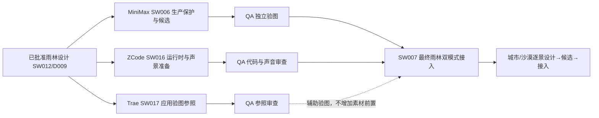

# 后续协同路线

2026-10-16基准main2339333；[实核报告](evidence/P-20261016-01/README.md)。可靠性、快照、森林正式接图、地形R2、森林/雨林设计、规格解析工具均accepted；不再重复安排这些开发，不用任务百分比代表MVP。

| 阶段 | 当前动作与退出条件 |
| --- | --- |
| 当下并行 | MiniMax SW006先0API生产尺寸/总预算/实际冻结批准保护，自检正确后按原总8次制图；ZCode SW016不等候选准备900m底座/合法声音；Trae SW017复用原设计做应用上下文参照 |
| 持续QA | 从当前已合main发组合测试Release，核APK/source/hash；提示出现/约3s消失与恢复不重播补实际时序证据；独立审三路交付，不用设计模拟替App |
| 雨林可用 | SW006与SW016各accepted后，SW007接批准图/实际声音/配置/可用性，两模式900m/恢复/停走/终态/多屏验证。此前不开放假完成入口 |
| 四景MVP | 雨林稳定后，SW008激活前拆城市1000m/沙漠1200m各自设计、素材、接入/预算；四景音视地形身份独立 |
| 实体/最终 | 设备矩阵可提前执行，锁屏15min/真实counter/重启/耳机来电/停止与最后5–8真实人体验；没有条件的项目Pending，严重问题关闭后RC |

SW017不改原SW012参数/素材design_ref，不成为额外付费制作门禁。SW003/SW013已完成，常驻验收职责不需新启动ID。所有权/独立worktree/handoff/精确review与merge不变，无自动消息或调度器。GitHub Actions是打包入口，不要求完善本地Android环境。主线App artifacts已有新版本，Release仍build109旧组合，QA需主动出准确组合包。较大source ZIP（约214.7MB）可作为后续独立打包优化，不混入本轮雨林功能。
