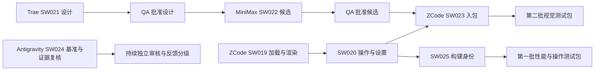

# 三份计划合并后的执行安排

2026-10-20，按用户要求阅读三份本地计划，筛选合理部分并安排四角色开发。本文件是 bootstrap 规划，不代表执行 agent 已收到提示、开工或完成。任务状态仍只看 [registry](../../registry.json)。

审阅基线：main `321060e945b512f3f6b8b038543eb3b9d16a58bc`；当前安装基准仍为 [build-176-aaa789b](https://github.com/skydream9527-ctrl/sense-walk/releases/tag/build-176-aaa789b)，源码 `aaa789b3afd789d121eb6f0c96189fe9835d3e3c`，312 项云端 JVM 测试。两者之间没有生产 app 或 Android 工作流改动。原始建议、修正与源码依据见 [SOURCE-REVIEW](SOURCE-REVIEW.md)，逐字快照及哈希见 [inputs/index.json](inputs/index.json)，可转发文本见 [PROMPTS](PROMPTS.md)。

## 目标与边界

本轮改善已经能玩的森林，而非重做可靠性、快照、越坎或森林光效。SW001、SW004、SW005、SW010、SW016、SW017、SW018 的 accepted 保留；物理设备项不自动完成。森林仍为 800m、雨林900m、城市1000m、沙漠1200m、夜径700m；不改 comfort_v1、1.4m/s 上限、距离揭示和30分钟被动恢复规则。

0m 保持近黑 void，不加绕过门禁的天空、雾或地面。改善构图只能在相应图层解锁后发生。场景开放条件继续按已批准内容决定，配置化不是开放新场景的授权。

## 本轮任务

| 任务 | 所有者 | 初始状态/前置 | 可验收成果 |
| --- | --- | --- | --- |
| [SW019](../../tasks/SW-019.md) 渲染与加载 | ZCode | ready；SW018 accepted | 后台解码、移除UI阻塞等待、高频读取下沉、有限缓存与前后对照 |
| [SW020](../../tasks/SW-020.md) 操作安全区与设置 | ZCode | queued，等SW019 | insets、步长设置接入实走、每局一次触感、文案纠正 |
| [SW021](../../tasks/SW-021.md) 森林视觉与界面设计 | Trae Design | ready；SW017 accepted | 平铺规范、三层更新设计、跨屏旅人、UI排版/结果/署名设计；0付费 |
| [SW022](../../tasks/SW-022.md) 森林平铺候选 | MiniMax | queued，等SW021独立批准 | 批准设计下的候选、接缝/三底/偏移检查与真实哈希；0付费 |
| [SW023](../../tasks/SW-023.md) 视觉入包与界面精修 | ZCode | queued，等SW019/020/021/022 | 明确区分cover/tile渲染，批准素材入包，mood/主题/排版/结果退暗/署名 |
| [SW024](../../tasks/SW-024.md) 独立基准与证据复核 | Antigravity | ready；SW017/018 accepted | 可复用的比较方案、提示缺证复核、UI回归及发布验收清单 |
| [SW025](../../tasks/SW-025.md) 构建版本可追溯 | ZCode | queued，等SW020 | App可见版本与SHA、递增versionCode、APK元数据与发布记录一致 |

SW019 → SW020 → SW025 由 ZCode 顺序做，分别交独立PR；SW021与SW024同时可做。MiniMax现在可先消费SW006现有rework，完成零API保护与准确交接；SW021 approved后再做SW022。不要四人同时改 app 或同一 Git index。

箭头中的批准必须有精确head及manifest哈希，不能用设计PNG、候选存在或任务自报代替。MiniMax无需等新设计才能处理自己原有guard，但不能提前执行SW022。

## 两次发布，不让素材等待阻塞功能改进

第一批：SW019、SW020、SW025各自获独立批准并合入，Antigravity确认云端test/lint/build、来源/哈希、回归结果和已知项后，发布新的森林测试tag。复用现有正式五层，**不等SW021/022/023**。旧build176 APK和tag保持原样。没有性能前后数据时只报告“完成线程/状态读取改造”，不能报告已提升帧率或节电。

第二批：SW021设计 → SW022候选 → SW023生产接线依次审核。审核设计、候选和实际App是三件事。连续位移与旅人/排版等可按独立提交呈现，但SW023的accepted要求任务全部验收项完成；缺合格平铺候选就保留cover，不强行重复非无缝原图。

两批都需记录APK SHA256、源码SHA、可见版本、versionCode、证书指纹、实际测试、已知项及回滚tag。仅文档改动不触发重发。可运行的真机项目继续记录；缺设备不阻塞独立开发或有限范围测试包，不冒充最终MVP。

## 怎样证明改进

SW024先固定比较脚本/步骤，至少记录设备或模拟器、系统、分辨率、刷新率、build类型、源码SHA及冷/热启动条件。比较同一环境下的入场加载、0/100/265/425/630/785m、末段移动、松手停稳、暂停/恢复、通关。重组计数、帧时间/卡顿和解码/分配指标按实际工具能力填写；阈值由同环境基准确定，不采用“零分配”“必然60fps”等未经测量结论。debug/release与不同设备数据不混比。

不能通过降低计距采样、跳过音频onFrame、丢弃事件或降低相位精度获得性能数字。异步图片就绪不得提前显示未解锁图层；重复进入/后台取消不泄漏缓存或把旧场景图写入新场景。停稳冻结、reduceMotion、终态只导航一次、恢复不补距须保持。

UI检查覆盖刘海/挖孔、手势/三键导航、小屏/长屏、大字号、TalkBack、按住前进替代。布局以安全内容区计算上下55%/45%，场景背景可延伸到边缘，控件和手势不被系统栏遮挡。真机计步/锁屏15min/来电/实体触感仍各自Pending，直到有实际证据。

## 后续采用，暂不混入本轮

| 建议 | 后续条件 |
| --- | --- |
| AudioFocus封装、公共WalkSnapshot、轻量AppContainer | 当前两批稳定后，按实际重复和回归成本单独小PR；共享实现不等于两模式共享一个可变焦点会话对象 |
| PhaseScheduler缓存、Canvas对象复用、音量去重 | 分配/调用测量确实指向热点后再做；淡入、0/1端点、事件所有权不能变化 |
| availableModes配置化 | 雨林组合前由QA登记兼容默认关闭/validator任务；不借字段默认值开放未验场景 |
| SW006正式雨林、真实声景、SW007组合 | 继续原SW012/D009，保持tileable=false；原总8次预算沿用、不重置；下一批启用由QA登记，不借森林优化改雨林设计 |
| 跑步平静提醒 | 步长链路稳定后另立任务，计距仍按上限，不由稀疏counter批次伪造实时步频 |
| R8、Baseline Profile、依赖升级、Media3 | 有启动/包体/循环听辨基准后分别验收，不作为本轮前置 |
| GPS/车载辅助、行走手账、时辰变体、更多景/手表/小组件/Health Connect | 按DEVELOPMENT优先级与实测反馈另排；不增加本轮位置权限或新数据范围 |

关于页署名来自实际ASSETS来源与许可原文；“本地保存”文案要经过代码核查，不能写未经核实的绝对隐私承诺。未开放场景保留可理解的说明，不照搬“去掉暂未开放角标”使用户误以为能玩。

## 文件交接

各作者只写本人范围与state/handoff；本轮规划没有代写private state。每项业务提交后追加 H-SW-xxx-R1.json + Markdown，精确base/head、实际测试及Pending。Antigravity审核后更新registry/BOARD并顺序集成。旧handoff、review、证据、决策不覆盖。持续QA不需要每轮新造协调任务；SW024完成的是基准/复核交付，不代表未来全部产品代码都已通过。
